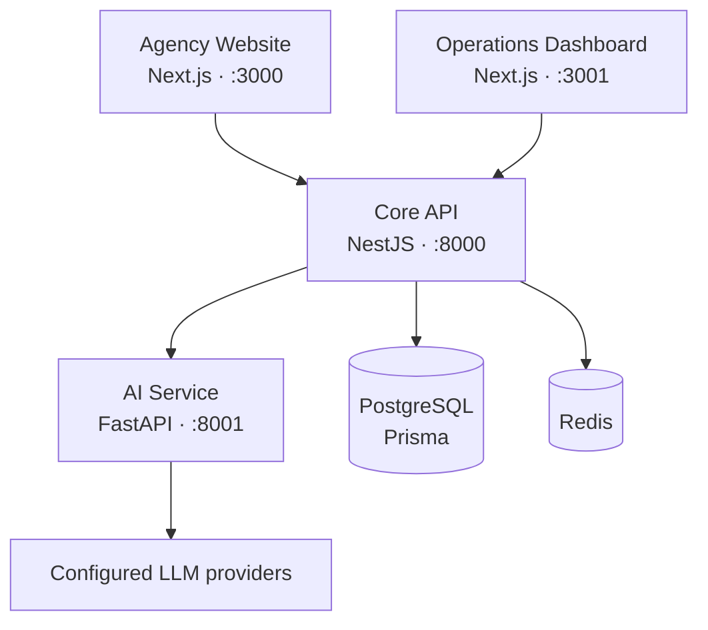

# TriFusion Dynamics — AgencyOS

<p align="center">
  <strong>A unified operating system for digital agencies and service teams.</strong><br/>
  CRM · Projects · HR · Billing · Helpdesk · AI · Automation · Analytics
</p>

<p align="center">
  <a href="https://trifusiondynamics.vercel.app/">Website</a> ·
  <a href="https://github.com/abx15/trifusiondynamics">Source</a> ·
  <a href="https://github.com/abx15/trifusiondynamics/issues">Issues</a> ·
  <a href="https://github.com/abx15/trifusiondynamics/discussions">Discussions</a> ·
  <a href="https://trifusiondynamics.vercel.app/contact">Contact</a>
</p>

<p align="center">
  
  
  
  
  
  
</p>

**TriFusion Dynamics** is the engineering organization. **AgencyOS** is the agency-operations platform in this repository. It brings customer and lead management, project delivery, workforce operations, finance, support, AI-assisted workflows, automation and developer integrations into one workspace.

This is an actively evolving monorepo. Feature availability and production readiness can differ by module. Code presence is not a certification that a workflow is complete, secure or enabled in every deployment. Review the [roadmap](docs/ROADMAP.md) and relevant tests before relying on a capability.

## Contents

- [Platform capabilities](#platform-capabilities)
- [Repository map](#repository-map)
- [Architecture](#architecture)
- [Technology stack](#technology-stack)
- [Quick start](#quick-start)
- [Environment configuration](#environment-configuration)
- [Database workflow](#database-workflow)
- [Useful commands](#useful-commands)
- [API reference](#api-reference)
- [Testing](#testing)
- [Deployment](#deployment)
- [Security](#security)
- [Contributing](#contributing)
- [Roadmap](#roadmap)
- [Services and sponsorship](#services-and-sponsorship)
- [License](#license)

## Platform capabilities

| Domain | Capabilities represented in the repository |
|---|---|
| CRM | Lead capture, lead stages, client records, quotes and conversion workflows |
| Project delivery | Projects, tasks, sprints, milestones and assignments |
| HR | Employee records, attendance, leave requests and recruitment |
| Finance | Salary structures, payslips, invoices, estimates, expenses and subscriptions |
| Helpdesk | Tickets, messages, routing, departments, SLAs and client support views |
| Client experience | Project, invoice, document and ticket pages within the dashboard |
| AI tools | Proposal generation, SEO audit, email writing, meeting summaries and chat |
| Automation | Workflow definitions, triggers, conditions, scheduling and run history |
| Analytics | Revenue, client growth, team performance and rollup jobs |
| Developer platform | API keys, webhooks, delivery records and request logs |
| Platform operations | Organization administration, role/permission management, notifications, storage, queues and health checks |

These are codebase capability areas, not a promise that every flow is complete or production-ready. Verify the relevant controllers, services, guards, UI and tests.

## Repository map

| Path | Component | Responsibility | Port |
|---|---|---|---:|
| `apps/agency-web` | Public website | Services, portfolio, blog, contact and public content | 3000 |
| `apps/admin-dashboard` | Operations dashboard | Admin, super-admin, agent, employee, HR and client-facing pages | 3001 |
| `services/auth` | NestJS API | Authentication, business modules, REST and WebSocket gateway | 8000 |
| `services/ai-service` | FastAPI service | Internal AI endpoints and model-provider integrations | 8001 host |
| `packages/database` | Prisma package | Schema, migrations, client generation and seed tooling | — |
| `packages/types` | Shared types | Cross-application TypeScript contracts | — |
| `packages/ui` | Shared UI | Reusable UI components | — |
| `packages/config` | Shared config | Shared configuration | — |

The public website currently lists AI/RAG, SaaS, mobile, cloud, ERP/CRM, cybersecurity, UI/UX, automation, web, e-commerce, SEO, API integration and maintenance services. See the [live services catalogue](https://trifusiondynamics.vercel.app/services). These are commercial service offerings, not all standalone modules in AgencyOS.

## Architecture



The backend is a modular NestJS application with modules for authentication, users, clients, projects, HR, payroll, billing, helpdesk, AI orchestration, analytics, automation, developer tooling, notifications, storage, queues and health/failover operations. PostgreSQL is the primary application datastore; Redis supports cache, rate-limit and ephemeral coordination. The AI service exposes internal FastAPI routes and integrates with configured model providers.

See [architecture documentation](docs/architecture/README.md), [authentication flow](docs/architecture/auth-flow.md) and [tenant isolation guidance](docs/architecture/tenant-isolation.md).

## Technology stack

- **Web:** Next.js 16, React 19, TypeScript, Tailwind CSS 4
- **API:** Node.js, NestJS 11, Express, TypeScript
- **AI:** Python, FastAPI, Pydantic, Uvicorn
- **Data:** PostgreSQL, Prisma ORM, Redis
- **Workspace:** pnpm 10.26.1, Turborepo
- **Quality/operations:** ESLint, Jest, Playwright, Newman, Docker, GitHub Actions
- **Deployment integrations:** Vercel, Render and managed database/cache providers

The lockfile is the source of truth for resolved package versions.

## Quick start

### Prerequisites

- Git
- Node.js 20+ (supported LTS compatible with the lockfile)
- pnpm **10.26.1**
- Python 3.11+ for AI service development
- Docker Engine/Desktop and Compose, or managed PostgreSQL and Redis

### 1. Clone and install

```bash
git clone https://github.com/abx15/trifusiondynamics.git
cd trifusiondynamics
corepack enable
corepack prepare pnpm@10.26.1 --activate
pnpm install --frozen-lockfile
```

### 2. Configure environment

```bash
cp .env.example .env
cp services/ai-service/.env.example services/ai-service/.env
```

Set valid local PostgreSQL and Redis URLs, separate strong JWT secrets, allowed CORS origins and provider credentials for the features you intend to run. Generate secrets with `openssl rand -hex 32`. Never commit environment files.

See [configuration guide](docs/development/configuration.md).

### 3. Start local infrastructure

```bash
docker compose -f infra/docker/docker-compose.yml up -d postgres redis
```

Skip this if using managed development databases.

### 4. Generate Prisma Client and apply migrations

```bash
pnpm --filter @agency-os/database db:generate
pnpm --filter @agency-os/database db:migrate:deploy
```

Use `db:migrate:dev` for schema development against a disposable local database. Never use the unsafe db-push script in production.

### 5. Run applications

In separate terminals:

```bash
pnpm --filter auth dev
pnpm --filter agency-web dev
pnpm --filter admin-dashboard dev
```

For FastAPI:

```bash
cd services/ai-service
python -m venv .venv
# Windows PowerShell:
.venv\Scripts\Activate.ps1
# macOS/Linux:
# source .venv/bin/activate
python -m pip install -r requirements.txt
python -m uvicorn app.main:app --reload --host 0.0.0.0 --port 8001
```

### Local URLs

- Website: http://localhost:3000
- Dashboard: http://localhost:3001
- NestJS API: http://localhost:8000/api
- API health: http://localhost:8000/api/health
- Swagger UI: http://localhost:8000/api/docs (when enabled)
- AI health: http://localhost:8001/health

A working local setup requires valid configuration and reachable dependencies. This quick start does not provision production accounts or customer data.

## Environment configuration

Start with the [root template](.env.example) and [AI service template](services/ai-service/.env.example).

| Variable | Purpose |
|---|---|
| `DATABASE_URL` | Runtime PostgreSQL connection |
| `DIRECT_URL` | Direct PostgreSQL connection for migrations |
| `REDIS_URL` | Redis connection |
| `JWT_ACCESS_SECRET` | Access-token signing secret; API enforces 32-character minimum |
| `JWT_REFRESH_SECRET` | Refresh-token signing secret; use a different value |
| `CORS_ALLOWED_ORIGINS` | Comma-separated allowed browser origins |
| `AI_SERVICE_URL` | NestJS-to-AI service URL |
| `AI_SERVICE_SECRET` | Internal service-to-service secret |
| `OPENAI_API_KEY`, `ANTHROPIC_API_KEY`, `GEMINI_API_KEY` | Optional model-provider credentials |
| `SENTRY_DSN` | Optional error monitoring |

Use encrypted deployment secret stores. Never expose private credentials through `NEXT_PUBLIC_*` variables.

## Database workflow

Prisma schema: `packages/database/prisma/schema.prisma`.

```bash
pnpm --filter @agency-os/database db:generate
pnpm --filter @agency-os/database db:migrate:deploy
# For local schema development:
pnpm --filter @agency-os/database db:migrate:dev
```

Production changes require reviewed migrations, backups and a controlled rollout. Read [migration safety](docs/operations/database-migrations.md) and [backup/recovery](docs/operations/backup-and-recovery.md).

## Useful commands

| Command | Description |
|---|---|
| `pnpm dev` | Run workspace development tasks |
| `pnpm build` | Build workspace packages and apps |
| `pnpm lint` | Run configured workspace lint tasks |
| `pnpm clean` | Clean workspace outputs |
| `pnpm --filter auth build` | Build NestJS API |
| `pnpm --filter auth test` | Run API unit tests |
| `pnpm --filter @agency-os/database db:generate` | Generate Prisma Client |
| `pnpm --filter @agency-os/database db:migrate:deploy` | Apply committed migrations |
| `pnpm run test:api` | Run Newman API collection |
| `pnpm docker:up` | Start configured Compose stack |
| `pnpm docker:down` | Stop configured Compose stack |

Package scripts are authoritative; not every workspace package defines every command.

## API reference

The NestJS service configures API reference endpoints:

- Swagger UI: `/api/docs`
- Scalar: `/api/docs/scalar`
- ReDoc: `/api/docs/redoc`
- OpenAPI JSON: `/api/docs-json` (subject to current app configuration)

See [API guide](docs/api/README.md), [route inventory](docs/architecture/actual-routes.md) and [OpenAPI snapshot](docs/swagger.json). Checked-in snapshots can become stale; the running API document and current source are authoritative. Verify DTOs, guards, role permissions and tenant scope before integrating.

## Testing

```bash
pnpm lint
pnpm build
pnpm --filter auth test
pnpm run test:api
```

For browser tests inspect `playwright.config.ts` and `e2e/`. AI tests may require Python dependencies or mocked provider clients. Do not report skipped checks as passing. See [testing guide](docs/development/testing.md).

## Deployment

The repository includes Vercel/Render and Docker deployment configuration. Provider project names, domains, secrets and deployment status can change independently of source. Confirm live provider settings before deploying.

- [Deployment overview](docs/deployment/README.md)
- [Production checklist](docs/deployment/production-checklist.md)
- [Render blueprint](render.yaml)
- [Development Compose](infra/docker/docker-compose.yml)
- [Production Compose](infra/docker/docker-compose.prod.yml)
- [CI workflows](.github/workflows/)

## Security

Report vulnerabilities privately; do not publish exploit details, secrets or customer data in public issues. See [SECURITY.md](SECURITY.md).

Tenant scope must be derived from authenticated server-side identity, not arbitrary request-body fields. Test cross-organization access for every protected data path. See [tenant isolation guidance](docs/architecture/tenant-isolation.md).

## Contributing

Bug reports, reproducible tests, documentation improvements, accessibility fixes and focused feature proposals are welcome, subject to the repository's licensing status.

1. Read [CONTRIBUTING.md](CONTRIBUTING.md).
2. Search [issues](https://github.com/abx15/trifusiondynamics/issues) and [discussions](https://github.com/abx15/trifusiondynamics/discussions).
3. Discuss large architectural changes before implementation.
4. Submit focused PRs with tests and docs.

**Licensing note:** this repository currently has no root license file and the API package is marked `UNLICENSED`. Public visibility does not grant rights to reuse, redistribute or commercially exploit the code. Maintainers should publish explicit licensing and contribution terms before positioning it as open source.

## Roadmap

See [ROADMAP.md](docs/ROADMAP.md) for security priorities, engineering improvements and proposed integrations. Roadmap entries are not delivery commitments until accepted and tracked.

## Services and sponsorship

TriFusion Dynamics offers services including SaaS/product engineering, AI/RAG integration, mobile engineering, cloud infrastructure, ERP/CRM, cybersecurity, UI/UX, automation, web/e-commerce development, SEO, API integration and maintenance.

- [Explore services](https://trifusiondynamics.vercel.app/services)
- [Discuss a project or partnership](https://trifusiondynamics.vercel.app/contact)
- [Sponsorship information](SPONSORING.md)

Sponsorship alone does not purchase roadmap control, guaranteed delivery, service-level commitments or IP ownership. Commercial work requires a separate written agreement defining scope, milestones, security responsibilities and support.

## Documentation map

- [All documentation](docs/README.md)
- [Architecture](docs/architecture/README.md)
- [Development](docs/development/README.md)
- [API](docs/api/README.md)
- [Deployment](docs/deployment/README.md)
- [Operations](docs/operations/README.md)
- [Changelog](CHANGELOG.md)
- [Support](SUPPORT.md)
- [Code of Conduct](CODE_OF_CONDUCT.md)

---

<p align="center">
  Built and maintained by <a href="https://github.com/abx15">TriFusion Dynamics</a>.
</p>
