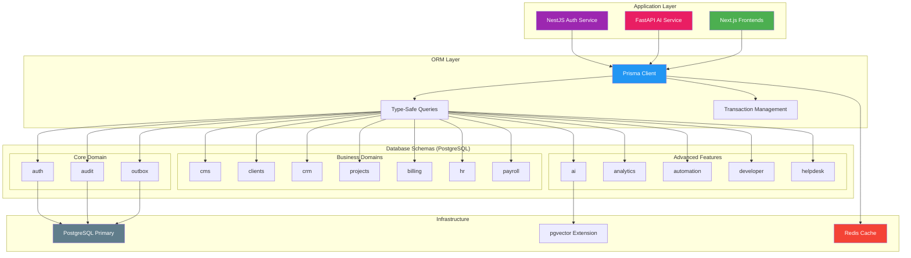
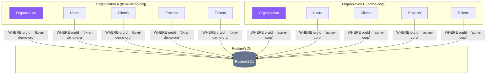
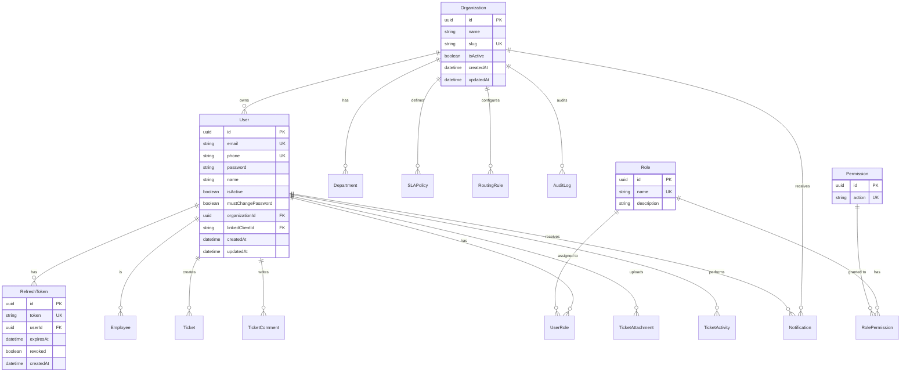
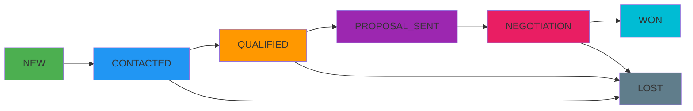
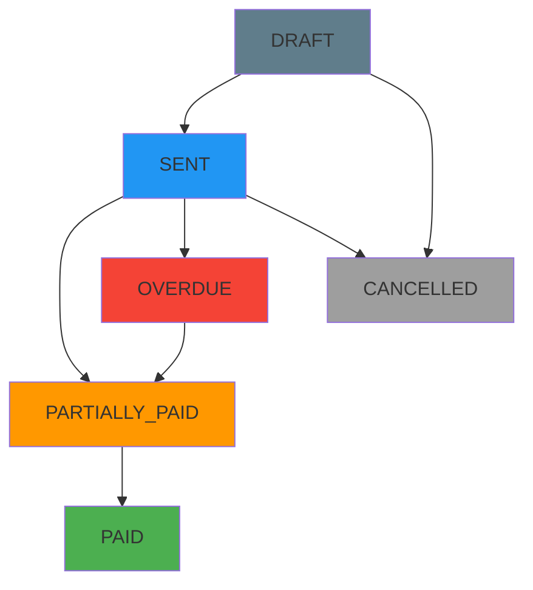
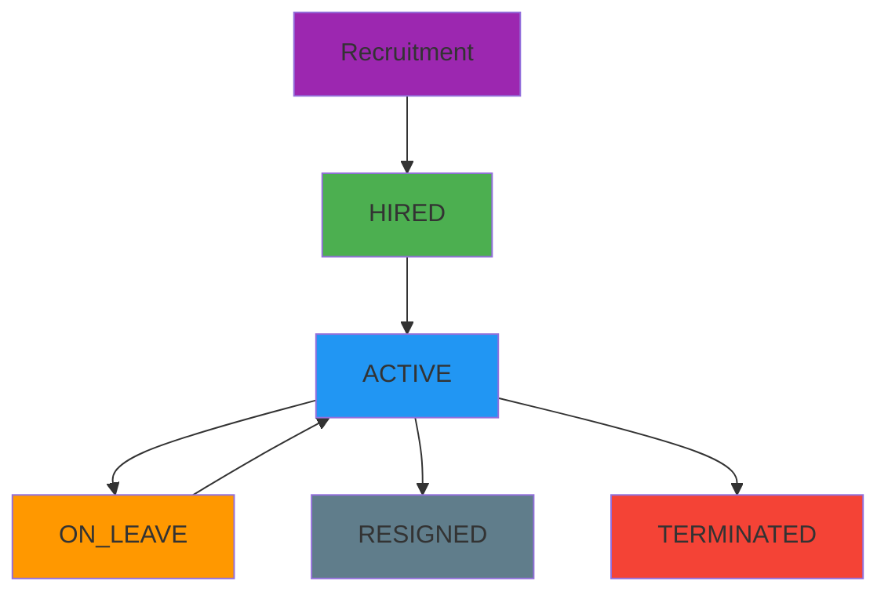
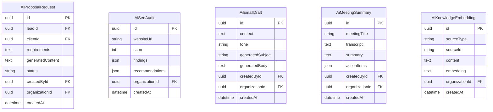
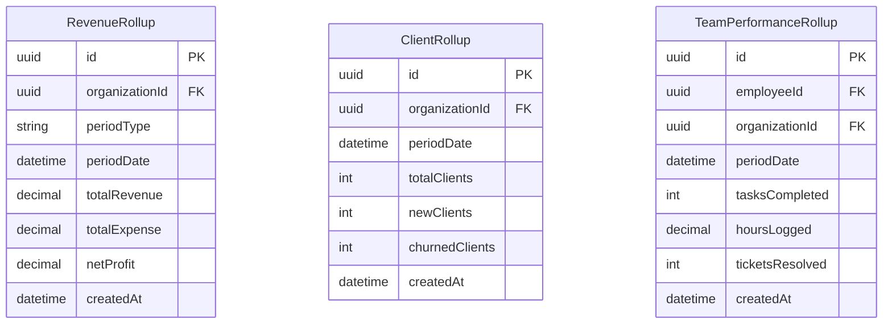
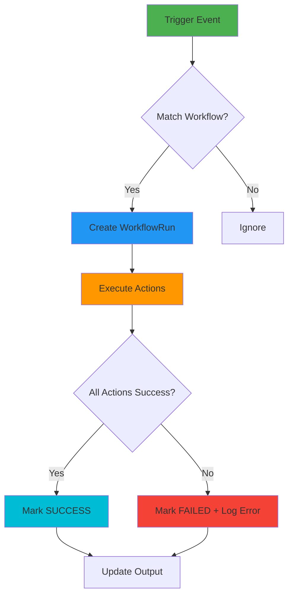
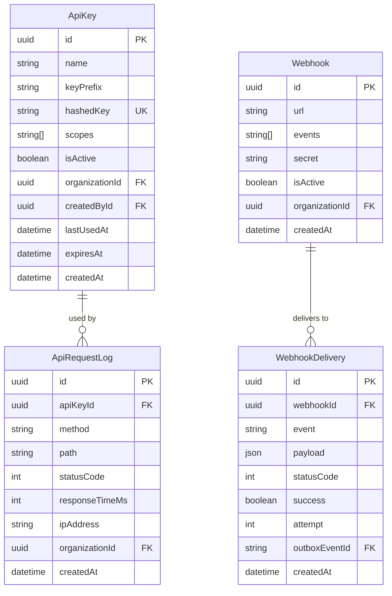

# AgencyOS Database Schema - Complete Guide with Diagrams, Patterns & Layers

> **Version:** 2.0  
> **Last Updated:** 2026-10-11  
> **Database:** PostgreSQL 16 (Neon)  
> **ORM:** Prisma 5.14 with Multi-Schema  
> **Total Schemas:** 15  
> **Total Models:** 70+  

---

## 📊 Architecture Overview

### Database Layer Architecture



---

## 🏗️ Schema Organization Pattern

### Schema Layering Strategy

The database follows a **Domain-Driven Design (DDD)** approach with schema segregation:

| Layer | Schemas | Purpose | Tenant Isolation |
|-------|---------|---------|------------------|
| **Foundation** | `auth`, `audit`, `outbox` | Core identity, events, and audit trails | Global & Multi-tenant |
| **Business Core** | `cms`, `clients`, `crm`, `projects`, `billing`, `hr`, `payroll` | Primary business domains | Multi-tenant (org-scoped) |
| **Advanced** | `ai`, `analytics`, `automation`, `developer`, `helpdesk` | Intelligent features & integrations | Multi-tenant (org-scoped) |

### Multi-Tenant Isolation Pattern



---

## 📋 Schema-by-Schema Analysis

### 1. AUTH Schema - Foundation Layer

**Purpose:** Identity, authentication, and authorization foundation

#### Models & Relationships



#### Key Patterns

| Pattern | Implementation | Purpose |
|---------|---------------|---------|
| **RBAC** | Role → RolePermission → Permission | Granular access control |
| **Refresh Token Rotation** | RefreshToken with expiry & revocation | Secure session management |
| **Multi-tenant Root** | Organization as parent entity | Tenant isolation anchor |
| **Soft Cascade** | `onDelete: Restrict` on User→Organization | Prevent accidental org deletion |

#### Security Considerations

- **Password Hashing:** bcrypt (handled in application layer)
- **Token Storage:** HttpOnly cookies (not in DB)
- **Audit Trail:** All mutations logged in `audit.AuditLog`
- **Rate Limiting:** Redis-backed, schema-agnostic

---

### 2. CMS Schema - Content Management

**Purpose:** Public-facing content and lead capture

#### Models

```mermaid
erDiagram
    ContactSubmission {
        uuid id PK
        string name
        string email
        string phone
        string company
        string subject
        text message
        string source
        enum status
        datetime createdAt
        datetime updatedAt
    }

    enum SubmissionStatus {
        NEW
        CONTACTED
        ARCHIVED
    }
```

#### Patterns

| Pattern | Description |
|---------|-------------|
| **Global Scope** | No organizationId - public submissions |
| **Status Workflow** | NEW → CONTACTED → ARCHIVED |
| **Lead Generation** | Integrates with CRM Lead conversion |

---

### 3. CLIENTS Schema - Customer Management

**Purpose:** Client information and contact management

#### Models & Relationships

```mermaid
erDiagram
    Client ||--o{ ClientContact : "has"
    Client ||--o{ Ticket : "raises"
    Client ||--o{ Project : "has"
    Client ||--o{ Invoice : "receives"

    Client {
        uuid id PK
        string name
        string companyName
        string email
        string phone
        string address
        string gstNumber
        enum status
        uuid organizationId FK
        uuid leadId FK UK
        datetime createdAt
        datetime updatedAt
    }

    ClientContact {
        uuid id PK
        uuid clientId FK
        string name
        string role
        string email
        string phone
        boolean isPrimary
        datetime createdAt
    }

    enum ClientStatus {
        ACTIVE
        INACTIVE
        ARCHIVED
    }
```

#### Patterns

| Pattern | Implementation | Risk Level |
|---------|---------------|------------|
| **Lead-to-Client** | `leadId` unique reference | Low |
| **Contact History** | Multiple contacts per client | Low |
| **Status Lifecycle** | ACTIVE → INACTIVE → ARCHIVED | Low |

⚠️ **Note:** Missing FK to Organization (P2 migration needed)

---

### 4. CRM Schema - Sales Pipeline

**Purpose:** Lead management and sales pipeline tracking

#### Models & Relationships

```mermaid
erDiagram
    Lead ||--o{ FollowUp : "has"
    Lead ||--o{ Quote : "quoted"
    Lead ||--o{ Client : "converts to"

    FollowUp {
        uuid id PK
        uuid leadId FK
        text note
        datetime scheduledAt
        datetime completedAt
        uuid createdById FK
        datetime createdAt
    }

    Quote {
        uuid id PK
        uuid leadId FK
        uuid clientId FK
        string title
        json items
        decimal totalAmount
        enum status
        datetime validUntil
        uuid organizationId FK
        datetime createdAt
        datetime updatedAt
    }

    Lead {
        uuid id PK
        string name
        string email
        string phone
        string companyName
        enum source
        enum stage
        decimal estimatedValue
        text notes
        uuid assignedToId FK
        uuid organizationId FK
        uuid convertedToClientId FK UK
        datetime createdAt
        datetime updatedAt
    }

    enum LeadSource {
        WEBSITE
        REFERRAL
        FIVERR
        UPWORD
        LINKEDIN
        COLD_OUTREACH
        OTHER
    }

    enum PipelineStage {
        NEW
        CONTACTED
        QUALIFIED
        PROPOSAL_SENT
        NEGOTIATION
        WON
        LOST
    }

    enum QuoteStatus {
        DRAFT
        SENT
        ACCEPTED
        REJECTED
        EXPIRED
    }
```

#### Pipeline Flow Diagram



#### Patterns

| Pattern | Implementation | Business Value |
|---------|---------------|----------------|
| **Pipeline Tracking** | Stage enum with timestamps | Sales forecasting |
| **Follow-up Reminders** | Scheduled datetime | CRM automation |
| **Quote Management** | JSON items for flexibility | Dynamic pricing |
| **Lead Conversion** | 1:1 lead→client relationship | Revenue attribution |

⚠️ **Note:** Missing FKs to Organization & User (P2 migration needed)

---

### 5. PROJECTS Schema - Project Management

**Purpose:** Project, task, and sprint management

#### Models & Relationships

```mermaid
erDiagram
    Project ||--o{ Task : "contains"
    Project ||--o{ Milestone : "has"
    Project ||--o{ ProjectMember : "staffed by"
    Project ||--o{ Ticket : "related to"

    Task ||--o{ TimeLog : "logged against"
    Task ||--|| Sprint : "in"
    Sprint ||--o{ Task : "contains"

    Project {
        uuid id PK
        string name
        text description
        uuid clientId FK
        enum status
        datetime startDate
        datetime endDate
        decimal budget
        uuid organizationId FK
        datetime createdAt
        datetime updatedAt
    }

    Task {
        uuid id PK
        uuid projectId FK
        string title
        text description
        enum status
        enum priority
        uuid assignedToId FK
        datetime dueDate
        uuid sprintId FK
        int order
        datetime createdAt
        datetime updatedAt
    }

    Sprint {
        uuid id PK
        uuid projectId FK
        string name
        datetime startDate
        datetime endDate
        boolean isActive
        datetime createdAt
    }

    Milestone {
        uuid id PK
        uuid projectId FK
        string title
        datetime dueDate
        boolean isCompleted
        datetime completedAt
        datetime createdAt
    }

    ProjectMember {
        uuid id PK
        uuid projectId FK
        uuid userId FK
        string role
        datetime addedAt
    }

    TimeLog {
        uuid id PK
        uuid taskId FK
        uuid userId FK
        int minutes
        string note
        datetime loggedAt
    }

    enum ProjectStatus {
        PLANNING
        IN_PROGRESS
        ON_HOLD
        COMPLETED
        CANCELLED
    }

    enum TaskStatus {
        TODO
        IN_PROGRESS
        IN_REVIEW
        DONE
    }

    enum TaskPriority {
        LOW
        MEDIUM
        HIGH
        URGENT
    }
```

#### Kanban Board Flow


#### Patterns

| Pattern | Implementation | Purpose |
|---------|---------------|---------|
| **Agile Methodology** | Sprints + Kanban tasks | Iterative development |
| **Time Tracking** | TimeLog per task | Billing & analytics |
| **Team Collaboration** | ProjectMember with roles | Access control |
| **Milestone Tracking** | DateTime deadlines | Project planning |

⚠️ **Note:** Missing FKs to Organization, Client, User (P2 migration needed)

---

### 6. BILLING Schema - Financial Management

**Purpose:** Invoices, payments, and financial tracking

#### Models & Relationships

```mermaid
erDiagram
    Invoice ||--o{ Payment : "receives"
    Invoice ||--o{ Estimate : "converted from"

    Invoice {
        uuid id PK
        string invoiceNumber UK
        uuid clientId FK
        uuid projectId FK
        uuid quoteId FK
        json items
        decimal subtotal
        decimal gstPercentage
        decimal gstAmount
        decimal totalAmount
        enum status
        datetime issueDate
        datetime dueDate
        datetime paidAt
        text notes
        uuid organizationId FK
        datetime createdAt
        datetime updatedAt
    }

    Payment {
        uuid id PK
        uuid invoiceId FK
        decimal amount
        enum method
        string transactionRef
        datetime paidAt
        string notes
        datetime createdAt
    }

    Estimate {
        uuid id PK
        string estimateNumber UK
        uuid clientId FK
        uuid leadId FK
        json items
        decimal subtotal
        decimal totalAmount
        enum status
        datetime validUntil
        uuid organizationId FK
        uuid convertedToInvoiceId FK UK
        datetime createdAt
    }

    Subscription {
        uuid id PK
        uuid clientId FK
        string planName
        decimal amount
        enum billingCycle
        enum status
        datetime nextBillingDate
        datetime startedAt
        datetime cancelledAt
        uuid organizationId FK
    }

    ExpenseRecord {
        uuid id PK
        string title
        string category
        decimal amount
        datetime spentAt
        string notes
        uuid organizationId FK
        datetime createdAt
    }

    enum InvoiceStatus {
        DRAFT
        SENT
        PARTIALLY_PAID
        PAID
        OVERDUE
        CANCELLED
    }

    enum PaymentMethod {
        BANK_TRANSFER
        UPI
        RAZORPAY
        CASH
        CHEQUE
        OTHER
    }

    enum EstimateStatus {
        DRAFT
        SENT
        ACCEPTED
        REJECTED
        EXPIRED
    }

    enum BillingCycle {
        MONTHLY
        QUARTERLY
        YEARLY
    }

    enum SubscriptionStatus {
        ACTIVE
        PAUSED
        CANCELLED
    }
```

#### Invoice Lifecycle



#### Patterns

| Pattern | Implementation | Business Value |
|---------|---------------|----------------|
| **GST Calculation** | Percentage-based tax | Compliance |
| **Payment Protection** | `onDelete: Restrict` on Payment→Invoice | Financial integrity |
| **Estimate-to-Invoice** | 1:1 conversion flow | Sales workflow |
| **Subscription Billing** | Auto-renewal with dates | Recurring revenue |

⚠️ **Note:** Global `invoiceNumber`/`estimateNumber` collision risk (P2 migration to org-scoped)

---

### 7. HR Schema - Human Resources

**Purpose:** Employee management and workforce tracking

#### Models & Relationships

```mermaid
erDiagram
    Department ||--o{ Employee : "employs"
    Department ||--o{ SLAPolicy : "defines"
    Department ||--o{ RoutingRule : "owns"
    Department ||--o{ Ticket : "owns"

    Employee ||--o{ Leave : "requests"
    Employee ||--o{ EmployeeDocument : "has"
    Employee ||--o{ AttendanceRecord : "logs"
    Employee ||--o{ TicketAssignment : "assigned to"
    Employee ||--o{ Ticket : "requests"
    Employee ||--o{ RoutingRule : "auto-assigns"

    Department {
        uuid id PK
        uuid organizationId FK
        string name
        string code
        text description
        boolean isActive
        boolean isHelpdesk
        datetime createdAt
        datetime updatedAt
    }

    Employee {
        uuid id PK
        uuid userId FK UK
        string employeeCode UK
        uuid departmentId FK
        string departmentLegacy
        string designation
        datetime joiningDate
        enum employmentType
        enum status
        uuid reportingToId FK
        uuid organizationId FK
        datetime createdAt
        datetime updatedAt
    }

    Leave {
        uuid id PK
        uuid employeeId FK
        enum type
        datetime startDate
        datetime endDate
        text reason
        enum status
        uuid approvedById FK
        datetime createdAt
    }

    EmployeeDocument {
        uuid id PK
        uuid employeeId FK
        string type
        string fileUrl
        datetime uploadedAt
    }

    AttendanceRecord {
        uuid id PK
        uuid employeeId FK
        uuid organizationId FK
        string type
        datetime timestamp
        string location
        string notes
        datetime createdAt
    }

    Recruitment {
        uuid id PK
        string position
        string department
        string candidateName
        string candidateEmail
        string resumeUrl
        enum stage
        text notes
        uuid organizationId FK
        datetime createdAt
    }

    enum EmploymentType {
        FULL_TIME
        PART_TIME
        CONTRACT
        INTERN
    }

    enum EmployeeStatus {
        ACTIVE
        ON_LEAVE
        RESIGNED
        TERMINATED
    }

    enum LeaveType {
        SICK
        CASUAL
        EARNED
        UNPAID
    }

    enum LeaveStatus {
        PENDING
        APPROVED
        REJECTED
    }

    enum RecruitmentStage {
        APPLIED
        SCREENING
        INTERVIEW
        OFFERED
        HIRED
        REJECTED
    }
```

#### Employee Lifecycle



#### Patterns

| Pattern | Implementation | Purpose |
|---------|---------------|---------|
| **Department Isolation** | Organization-scoped unique names | Multi-tenant HR |
| **User-Employee Link** | 1:1 userId → employee relationship | Auth integration |
| **Attendance Tracking** | CHECK_IN/CHECK_OUT events | Time management |
| **Leave Workflow** | Approval chain with status | HR automation |
| **Recruitment Pipeline** | Stage-based candidate tracking | Hiring process |

⚠️ **Note:** Global `employeeCode` collision risk (P2 migration to org-scoped)

---

### 8. PAYROLL Schema - Salary Management

**Purpose:** Salary structures and payslip generation

#### Models & Relationships

```mermaid
erDiagram
    SalaryStructure ||--|| Employee : "for"
    Payslip ||--|| Employee : "for"
    BankDetail ||--|| Employee : "for"

    SalaryStructure {
        uuid id PK
        uuid employeeId FK UK
        decimal basicSalary
        decimal hra
        decimal allowances
        decimal deductions
        datetime effectiveFrom
    }

    Payslip {
        uuid id PK
        uuid employeeId FK
        int month
        int year
        decimal grossAmount
        decimal deductions
        decimal netAmount
        decimal tax
        enum status
        datetime paidAt
        string pdfUrl
        datetime createdAt
    }

    BankDetail {
        uuid id PK
        uuid employeeId FK UK
        string accountHolder
        string accountNumber
        string ifscCode
        string bankName
    }

    enum PayslipStatus {
        GENERATED
        PAID
    }
```

#### Patterns

| Pattern | Implementation | Business Value |
|---------|---------------|----------------|
| **Monthly Uniqueness** | `(employeeId, month, year)` composite unique | Prevent duplicate payslips |
| **Regulatory Retention** | No cascade deletes | Compliance |
| **Flexible Components** | HRA, allowances, deductions | Tax calculation |
| **Bank Details** | Secure storage for payouts | Direct deposit |

---

### 9. AI Schema - AI Features

**Purpose:** AI-powered features and embeddings

#### Models



#### Patterns

| Pattern | Implementation | Purpose |
|---------|---------------|---------|
| **Content Generation** | Store input + output | Audit trail |
| **Embedding Storage** | Text-based JSON (not pgvector) | Compatibility |
| **Organization Scoping** | All AI requests org-scoped | Cost attribution |
| **Source Tracking** | sourceType + sourceId | Knowledge base |

---

### 10. ANALYTICS Schema - Data Aggregation

**Purpose:** Pre-computed analytics rollups

#### Models



#### Patterns

| Pattern | Implementation | Business Value |
|---------|---------------|----------------|
| **Time-based Rollups** | Daily/Monthly aggregations | Fast dashboard queries |
| **Composite Uniqueness** | `(orgId, periodType, periodDate)` | Idempotent rollups |
| **Multi-metric** | Revenue, clients, performance | Comprehensive analytics |
| **Pre-computation** | Scheduled jobs | Query performance |

---

### 11. AUTOMATION Schema - Workflow Engine

**Purpose:** Event-driven automation workflows

#### Models & Relationships

```mermaid
erDiagram
    Workflow ||--o{ WorkflowRun : "executes"

    Workflow {
        uuid id PK
        string name
        enum triggerType
        json triggerConfig
        json actions
        boolean isActive
        uuid organizationId FK
        datetime createdAt
        datetime updatedAt
    }

    WorkflowRun {
        uuid id PK
        uuid workflowId FK
        enum status
        json input
        json output
        string errorMessage
        datetime startedAt
        datetime finishedAt
    }

    enum TriggerType {
        EVENT
        SCHEDULED
        MANUAL
    }

    enum RunStatus {
        SUCCESS
        FAILED
        RUNNING
    }
```

#### Workflow Execution Flow



#### Patterns

| Pattern | Implementation | Purpose |
|---------|---------------|---------|
| **Event-Driven** | Trigger config with event types | Reactive automation |
| **Action Chain** | JSON array of actions | Complex workflows |
| **Execution History** | WorkflowRun logs | Debugging & audit |
| **Conditional Logic** | JSON-based conditions | Flexible rules |

---

### 12. DEVELOPER Schema - API Management

**Purpose:** API keys, webhooks, and request logging

#### Models & Relationships



#### Patterns

| Pattern | Implementation | Security |
|---------|---------------|----------|
| **API Key Hashing** | bcrypt-hashed, never stored plain | Credential protection |
| **Scope-based Access** | Array of scopes (e.g., `crm:read`) | Fine-grained permissions |
| **Webhook HMAC** | Secret for signature verification | Payload integrity |
| **Request Logging** | Full HTTP context | Debugging & audit |
| **Outbox Integration** | `outboxEventId` for exactly-once delivery | Event reliability |

---

### 13. HELPDESK Schema - Support Ticketing

**Purpose:** Unified ticketing system with SLA management

#### Models & Relationships

```mermaid
erDiagram
    Ticket ||--o{ TicketComment : "has"
    Ticket ||--o{ TicketAttachment : "has"
    Ticket ||--o{ TicketAssignment : "assigned to"
    Ticket ||--o{ TicketActivity : "logged in"
    Ticket ||--o{ TicketEscalation : "escalated to"
    Ticket ||--o{ SLAPolicy : "governed by"

    TicketAssignment ||--|| Employee : "assigned to"
    TicketEscalation ||--|| User : "escalated by"

    Ticket {
        uuid id PK
        string ticketNumber UK
        enum type
        string title
        text description
        enum status
        enum priority
        enum category
        enum source
        uuid organizationId FK
        uuid requesterId FK
        uuid requesterEmployeeId FK
        string requesterRoleSnapshot
        uuid clientId FK
        uuid projectId FK
        uuid departmentId FK
        uuid assignedAgentId FK
        uuid slaPolicyId FK
        datetime firstResponseDeadline
        datetime firstRespondedAt
        datetime resolutionDeadline
        datetime slaResolutionBreachedAt
        datetime slaPausedAt
        bigint totalPausedDurationMs
        text resolution
        datetime verifiedAt
        datetime resolvedAt
        datetime closedAt
        enum escalationLevel
        datetime escalatedAt
        datetime reopenedCount
        datetime createdAt
        datetime updatedAt
        datetime lastActivityAt
    }

    TicketComment {
        uuid id PK
        uuid ticketId FK
        uuid userId FK
        text content
        boolean isInternal
        datetime createdAt
    }

    TicketAttachment {
        uuid id PK
        uuid ticketId FK
        uuid uploadedBy FK
        string fileName
        string fileUrl
        int fileSize
        string mimeType
        datetime createdAt
    }

    TicketAssignment {
        uuid id PK
        uuid ticketId FK
        uuid employeeId FK
        enum type
        uuid assignedBy FK
        datetime assignedAt
        datetime unassignedAt
        boolean isActive
        int sequence
    }

    TicketActivity {
        uuid id PK
        uuid ticketId FK
        uuid userId FK
        string action
        text description
        json metadata
        string ipAddress
        string userAgent
        datetime createdAt
    }

    TicketEscalation {
        uuid id PK
        uuid ticketId FK
        enum level
        enum trigger
        text reason
        uuid escalatedById FK
        datetime escalatedAt
        datetime clearedAt
        boolean notifiedAdmin
        boolean notifiedSuperAdmin
    }

    SLAPolicy {
        uuid id PK
        uuid organizationId FK
        string name
        uuid departmentId FK
        enum ticketType
        enum category
        enum priority
        int responseTimeMins
        int resolutionTimeMins
        int warningThresholdPercent
        boolean isDefault
        int policyOrder
        boolean isActive
    }

    RoutingRule {
        uuid id PK
        uuid organizationId FK
        string name
        enum ticketType
        enum category
        enum priority
        uuid departmentId FK
        uuid defaultAgentId FK
        uuid autoAssignEmployeeId FK
        uuid slaPolicyId FK
        int ruleOrder
        boolean isDefault
        boolean isActive
    }

    enum TicketType {
        CLIENT_SUPPORT
        INTERNAL
    }

    enum EscalationLevel {
        NONE
        ADMIN
        SUPER_ADMIN
    }

    enum EscalationTrigger {
        SLA_WARNING
        SLA_BREACH
        SLA_CRITICAL_BREACH
        MANUAL
        REOPENED
        CRITICAL_PRIORITY
        SECURITY
        SYSTEM_CRITICAL
    }

    enum TicketStatus {
        OPEN
        ASSIGNED
        IN_PROGRESS
        WAITING_FOR_CLIENT
        WAITING_FOR_EMPLOYEE
        RESOLUTION_SUBMITTED
        UNDER_VERIFICATION
        REOPENED
        RESOLVED
        CLOSED
        CANCELLED
    }

    enum TicketPriority {
        LOW
        MEDIUM
        HIGH
        URGENT
        CRITICAL
    }

    enum TicketCategory {
        TECHNICAL
        BILLING
        ACCOUNT
        FEATURE_REQUEST
        BUG_REPORT
        SECURITY
        PERFORMANCE
        IT_SUPPORT
        HR
        PAYROLL
        GENERAL
    }

    enum TicketSource {
        CLIENT_PORTAL
        EMAIL
        API
        INTERNAL
        PHONE
        SYSTEM
    }

    enum AssignmentType {
        PRIMARY
        SUPPORTING
    }
```

#### Ticket Lifecycle

```mermaid
graph TD
    A[OPEN] --> B[ASSIGNED]
    B --> C[IN_PROGRESS]
    C --> D[WAITING_FOR_CLIENT]
    C --> E[WAITING_FOR_EMPLOYEE]
    D --> C
    E --> C
    C --> F[RESOLUTION_SUBMITTED]
    F --> G[UNDER_VERIFICATION]
    G --> H[RESOLVED]
    G --> I[REOPENED]
    I --> C
    H --> J[CLOSED]
    B --> K[CANCELLED]

    style A fill:#607D8B
    style B fill:#2196F3
    style C fill:#FF9800
    style D fill:#9C27B0
    style E fill:#E91E63
    style F fill:#00BCD4
    style G fill:#4CAF50
    style H fill:#8BC34A
    style I fill:#FF5722
    style J fill:#009688
    style K fill:#9E9E9E
```

#### SLA Timeline

```mermaid
graph LR
    A[Ticket Created] -->|Response Clock Starts| B[First Response Deadline]
    B -->|80% Warning| C[SLA Warning]
    B -->|100% Breach| D[SLA Breach]
    A -->|Resolution Clock Starts| E[Resolution Deadline]
    E -->|80% Warning| F[SLA Warning]
    E -->|100% Breach| G[SLA Breach]
    D -->|Escalation| H[ADMIN]
    G -->|Escalation| I[SUPER_ADMIN]

    style A fill:#4CAF50
    style B fill:#2196F3
    style C fill:#FF9800
    style D fill:#F44336
    style E fill:#9C27B0
    style F fill:#FF9800
    style G fill:#F44336
    style H fill:#E91E63
    style I fill:#B71C1C
```

#### Patterns

| Pattern | Implementation | Business Value |
|---------|---------------|----------------|
| **Unified Ticketing** | Single table for all ticket types | Consistent logic |
| **SLA Enforcement** | Dual clocks (response + resolution) | Service quality |
| **Assignment History** | Append-only with `isActive` | Full audit trail |
| **Escalation Independence** | Separate from status | Clean workflow |
| **Routing Rules** | Database-driven, not hardcoded | Flexible assignment |
| **Role Snapshot** | Denormalized requester role | Audit safety |

---

### 14. AUDIT Schema - Immutable Audit Trail

**Purpose:** Append-only audit log for compliance

#### Model

```mermaid
erDiagram
    AuditLog {
        uuid id PK
        uuid organizationId FK
        string actorType
        uuid actorId
        string actorLabel
        string action
        string entityType
        string entityId
        json before
        json after
        json metadata
        string ipAddress
        string userAgent
        string requestId
        datetime createdAt
    }
```

#### Patterns

| Pattern | Implementation | Purpose |
|---------|---------------|---------|
| **Append-Only** | No update/delete paths | Immutable history |
| **Generic Entity** | entityType + entityId (no FK) | Flexibility |
| **SYSTEM Actor** | actorType = 'SYSTEM' | Automated actions |
| **Before/After** | JSON snapshots | Change tracking |
| **Request Correlation** | requestId for distributed tracing | Debugging |

---

### 15. OUTBOX Schema - Transactional Event Bus

**Purpose:** Reliable event delivery via transactional outbox pattern

#### Model

```mermaid
erDiagram
    OutboxEvent {
        uuid id PK
        string eventType
        json payload
        enum status
        int attempts
        int maxAttempts
        datetime nextAttemptAt
        datetime lockedAt
        string lockedBy
        datetime processedAt
        text lastError
        uuid organizationId FK
        string idempotencyKey
        datetime createdAt
    }

    enum OutboxStatus {
        PENDING
        PROCESSING
        PROCESSED
        FAILED
        DEAD
    }
```

#### Outbox Processing Flow

```mermaid
graph TD
    A[Business Transaction] --> B[Write OutboxEvent]
    B --> C[Commit Transaction]
    C --> D[Background Worker]
    D --> E[Claim with FOR UPDATE SKIP LOCKED]
    E --> F[Mark PROCESSING]
    F --> G[Execute Handler]
    G --> H{Success?}
    H -->|Yes| I[Mark PROCESSED]
    H -->|No| J[Increment attempts]
    J --> K{attempts < maxAttempts?}
    K -->|Yes| L[Set nextAttemptAt + Mark PENDING]
    K -->|No| M[Mark DEAD]
    L --> D
    I --> N[Done]

    style A fill:#4CAF50
    style B fill:#2196F3
    style C fill:#00BCD4
    style D fill:#FF9800
    style E fill:#9C27B0
    style F fill:#E91E63
    style G fill:#3F51B5
    style I fill:#8BC34A
    style M fill:#F44336
```

#### Patterns

| Pattern | Implementation | Purpose |
|---------|---------------|---------|
| **Transactional Guarantee** | Same transaction as business logic | Event consistency |
| **Idempotency** | Unique `(eventType, idempotencyKey)` | Exactly-once delivery |
| **Locking** | `FOR UPDATE SKIP LOCKED` | Concurrent worker safety |
| **Retry with Backoff** | `nextAttemptAt` + exponential backoff | Reliability |
| **Dead Letter** | DEAD status after max attempts | Error handling |

---

## 🔗 Cross-Schema Relationships

### Organization as Root Entity

```mermaid
graph TD
    subgraph "auth schema"
        A[Organization]
    end

    subgraph "clients schema"
        B[Client]
    end

    subgraph "crm schema"
        C[Lead]
        D[Quote]
    end

    subgraph "projects schema"
        E[Project]
    end

    subgraph "billing schema"
        F[Invoice]
        G[Estimate]
        H[Subscription]
        I[ExpenseRecord]
    end

    subgraph "hr schema"
        J[Employee]
        K[Recruitment]
    end

    subgraph "ai schema"
        L[AiProposalRequest]
        M[AiSeoAudit]
    end

    subgraph "analytics schema"
        N[RevenueRollup]
        O[ClientRollup]
    end

    subgraph "automation schema"
        P[Workflow]
    end

    subgraph "developer schema"
        Q[ApiKey]
        R[Webhook]
    end

    subgraph "helpdesk schema"
        S[Ticket]
        T[SLAPolicy]
        U[RoutingRule]
    end

    subgraph "audit schema"
        V[AuditLog]
    end

    B -.->|organizationId| A
    C -.->|organizationId| A
    D -.->|organizationId| A
    E -.->|organizationId| A
    F -.->|organizationId| A
    G -.->|organizationId| A
    H -.->|organizationId| A
    I -.->|organizationId| A
    J -.->|organizationId| A
    K -.->|organizationId| A
    L -.->|organizationId| A
    M -.->|organizationId| A
    N -.->|organizationId| A
    O -.->|organizationId| A
    P -.->|organizationId| A
    Q -.->|organizationId| A
    R -.->|organizationId| A
    S -->|organizationId FK| A
    T -->|organizationId FK| A
    U -->|organizationId FK| A
    V -->|organizationId FK| A

    style A fill:#f59e0b,color:#fff
    style S fill:#4CAF50,color:#fff
    style T fill:#2196F3,color:#fff
    style U fill:#9C27B0,color:#fff
    style V fill:#F44336,color:#fff
```

### User as Cross-Domain Actor

```mermaid
graph TD
    subgraph "auth schema"
        A[User]
    end

    subgraph "projects schema"
        B[Task]
        C[ProjectMember]
    end

    subgraph "helpdesk schema"
        D[Ticket]
        E[TicketComment]
        F[TicketAttachment]
        G[TicketActivity]
        H[TicketEscalation]
    end

    subgraph "ai schema"
        I[AiProposalRequest]
        J[AiEmailDraft]
        K[AiMeetingSummary]
    end

    subgraph "developer schema"
        L[ApiKey]
    end

    B -.->|assignedToId| A
    C -.->|userId| A
    D -->|requesterId FK| A
    D -->|assignedAgentId FK| A
    E -->|userId FK| A
    F -->|uploadedBy FK| A
    G -->|userId FK| A
    H -->|escalatedById FK| A
    I -.->|createdById| A
    J -.->|createdById| A
    K -.->|createdById| A
    L -.->|createdById| A

    style A fill:#f59e0b,color:#fff
    style D fill:#4CAF50,color:#fff
    style E fill:#2196F3,color:#fff
    style F fill:#9C27B0,color:#fff
    style G fill:#E91E63,color:#fff
    style H fill:#FF9800,color:#fff
```

---

## 🎯 Design Patterns Summary

### 1. Multi-Tenancy Pattern
- **Implementation:** `organizationId` on all tenant-scoped models
- **Isolation:** Query scoping via `WHERE organizationId = user.orgId`
- **Super Admin:** No orgId filter (universal access)

### 2. Soft Delete Pattern (Future - P2)
- **Status:** Not yet implemented
- **Plan:** Add `isDeleted` + `deletedAt` columns
- **Models:** Organization, Project, Client, Invoice, Employee

### 3. Audit Pattern
- **Implementation:** Append-only `audit.AuditLog`
- **Trigger:** All mutations logged
- **Actor:** USER or SYSTEM

### 4. Outbox Pattern
- **Implementation:** `outbox.OutboxEvent`
- **Purpose:** Reliable event delivery
- **Processing:** Background workers with `FOR UPDATE SKIP LOCKED`

### 5. SLA Pattern
- **Implementation:** Dual clocks (response + resolution)
- **Warning:** 80% threshold
- **Escalation:** Automatic on breach

### 6. Routing Pattern
- **Implementation:** Database-driven `RoutingRule`
- **Matching:** Specificity-based
- **Fallback:** Default rule per org

### 7. Assignment History Pattern
- **Implementation:** Append-only `TicketAssignment`
- **Active Flag:** `isActive` boolean
- **Sequence:** Incrementing sequence number

### 8. Role Snapshot Pattern
- **Implementation:** Denormalized `requesterRoleSnapshot`
- **Purpose:** Audit safety (role changes don't affect history)
- **Authorization:** Always uses live roles, never snapshot

### 9. Idempotency Pattern
- **Implementation:** Unique `(eventType, idempotencyKey)`
- **Use Case:** Outbox events, notifications
- **Benefit:** Exactly-once delivery

### 10. Generic Entity Pattern
- **Implementation:** `entityType` + `entityId` (no FK)
- **Use Case:** AuditLog, Notification
- **Trade-off:** No referential integrity for flexibility

---

## 📊 Index Strategy

### Primary Indexes

| Model | Primary Index | Type |
|-------|---------------|------|
| All | `id` (uuid) | PK |
| UserRole | `(userId, roleId)` | Composite PK |
| RolePermission | `(roleId, permissionId)` | Composite PK |
| ProjectMember | `(projectId, userId)` | Composite UK |
| RevenueRollup | `(organizationId, periodType, periodDate)` | Composite UK |
| ClientRollup | `(organizationId, periodDate)` | Composite UK |
| TeamPerformanceRollup | `(employeeId, periodDate)` | Composite UK |
| OutboxEvent | `(eventType, idempotencyKey)` | Composite UK |
| Notification | `(userId, dedupeKey)` | Composite UK |

### Query Optimization Indexes

| Schema | Model | Index | Purpose |
|--------|-------|-------|---------|
| auth | User | `organizationId` | Tenant scoping |
| auth | User | `email`, `phone` | Login lookup |
| crm | Lead | `(organizationId, stage, createdAt)` | Pipeline queries |
| projects | Task | `(projectId, status, createdAt)` | Kanban boards |
| projects | Task | `assignedToId` | User task lists |
| billing | Invoice | `(organizationId, status, createdAt)` | AR queries |
| billing | Invoice | `(clientId, status)` | Client billing |
| helpdesk | Ticket | `(organizationId, status, createdAt)` | Ticket queues |
| helpdesk | Ticket | `(assignedAgentId, isActive)` | Agent workloads |
| helpdesk | Ticket | `(resolutionDeadline, status)` | SLA monitoring |
| audit | AuditLog | `(organizationId, createdAt)` | Audit queries |
| outbox | OutboxEvent | `(status, nextAttemptAt)` | Worker processing |

---

## 🔒 Security & Data Integrity

### Cascade Behaviors

| Behavior | Models | Risk |
|----------|--------|------|
| **Cascade** | User→RefreshToken, Ticket→Comment, Workflow→WorkflowRun | Safe |
| **Restrict** | Payment→Invoice, User→Organization | Intentional safety |
| **SetNull** | Task→Sprint, Ticket→Department | Soft orphaning |

### Missing Foreign Keys (P2 Migration)

High-priority missing FKs:
- `Client.organizationId`
- `Lead.organizationId`
- `Project.organizationId`
- `Invoice.organizationId`
- `Employee.organizationId`
- `Lead.assignedToId`
- `Task.assignedToId`

### Global Unique Constraints (Collision Risk)

| Field | Current Scope | Recommended Scope |
|-------|---------------|-------------------|
| `Invoice.invoiceNumber` | Global | Organization-scoped |
| `Estimate.estimateNumber` | Global | Organization-scoped |
| `Employee.employeeCode` | Global | Organization-scoped |

---

## 🚀 Performance Considerations

### Read Patterns

1. **Tenant-Scoped Queries:** Always include `WHERE organizationId = ?`
2. **Pagination:** Use `take` + `skip` with cursor-based for large datasets
3. **Index Coverage:** Ensure indexes cover query predicates

### Write Patterns

1. **Transactions:** Multi-step writes wrapped in `$transaction`
2. **Outbox Events:** Written in same transaction as business logic
3. **Batch Operations:** Use `createMany` / `updateMany` where possible

### Query Optimization

```typescript
// ✅ Good - Indexed query
prisma.task.findMany({
  where: {
    projectId,
    status: 'IN_PROGRESS',
  },
  orderBy: { createdAt: 'desc' },
  take: 20,
})

// ❌ Bad - Unindexed sort
prisma.task.findMany({
  where: { projectId },
  orderBy: { title: 'asc' }, // No index on title
})
```

---

## 📝 Migration Strategy

### P0 (Critical - Immediate)
- None (schema is production-safe)

### P1 (High - Next Sprint)
- Add FK to `Organization` for all tenant-scoped models
- Scope global unique constraints to organization

### P2 (Medium - Next Quarter)
- Implement soft delete pattern
- Add composite indexes for slow queries
- Migrate global unique constraints

### P3 (Low - Future)
- Add `deletedAt` to all business entities
- Implement data archival strategy
- Add full-text search indexes

---

## 🎓 Best Practices

### Application Layer

1. **Always validate organizationId from JWT, never request body**
2. **Use `$transaction` for multi-step writes**
3. **Bound `findMany` calls with `take`**
4. **Never use `db push` in production - use `migrate deploy`**
5. **Apply session-level GUCs in `onModuleInit`**

### Database Layer

1. **Use tagged template literals for raw SQL**
2. **Never use `$queryRawUnsafe` with user input**
3. **Add production guards to destructive scripts**
4. **Apply `onDelete: Restrict` for critical relationships**
5. **Use `@@unique` for business constraints**

### Testing

1. **Test migrations in staging first**
2. **Validate schema with `prisma validate`**
3. **Check for schema drift before deploy**
4. **Test rollback procedures**

---

## 📚 Related Documentation

- [Database Schema Audit](DATABASE_SCHEMA_AUDIT.md) - Model-by-model risk analysis
- [PostgreSQL Production Hardening](POSTGRESQL_PRODUCTION_HARDENING_REPORT.md) - Production readiness
- [Redis Architecture](REDIS_ARCHITECTURE.md) - Cache layer design
- [Migration Safety](PRISMA_MIGRATION_SAFETY.md) - Safe migration practices
- [System Architecture](architecture/SYSTEM_ARCHITECTURE.md) - Overall system design

---

**Document Status:** ✅ Complete  
**Last Review:** 2026-10-11  
**Next Review:** 2026-11-11
