# AgencyOS Architecture Patterns & Layers

> **Version:** 2.0  
> **Last Updated:** 2026-10-11  
> **Architecture Style:** Modular Monolith with Microservice Extensions  
> **Pattern Language:** DDD, CQRS, Event-Driven, Multi-Tenant SaaS

---

## 🏗️ High-Level Architecture Layers

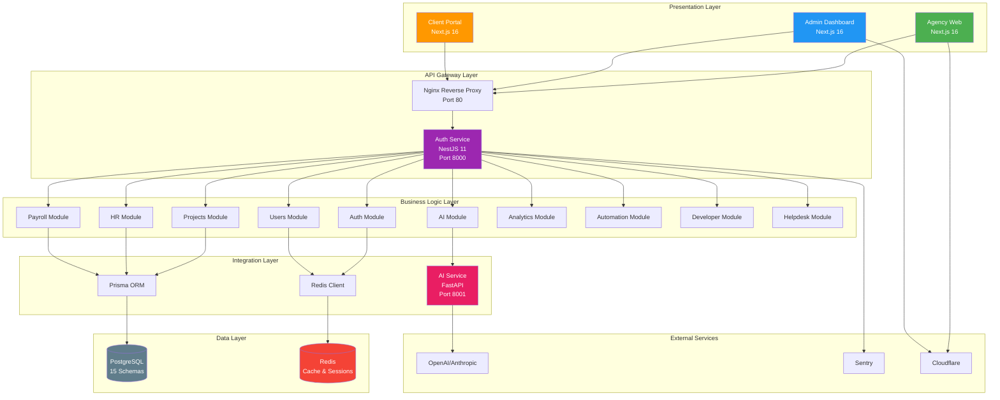

---

## 📐 Architectural Patterns

### 1. Modular Monolith Pattern

**Purpose:** Balance simplicity with future microservice migration

#### Implementation

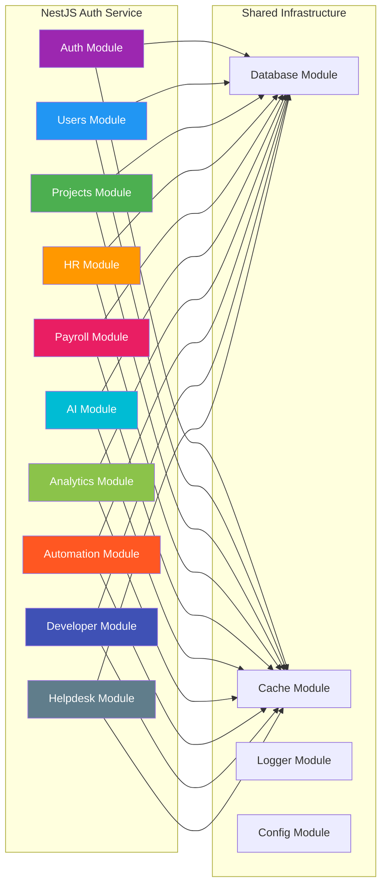

#### Benefits

| Benefit | Description |
|---------|-------------|
| **Simplicity** | Single deployment, shared database |
| **Performance** | In-process communication, no network overhead |
| **Consistency** | ACID transactions across modules |
| **Observability** | Single log stream, distributed tracing optional |
| **Migration Path** | Modules can be extracted to microservices later |

#### Module Boundaries

```typescript
// Each module is self-contained
@Module({
  imports: [
    DatabaseModule,
    CacheModule,
  ],
  controllers: [ProjectsController],
  providers: [
    ProjectsService,
    ProjectsRepository,
  ],
  exports: [ProjectsService],
})
export class ProjectsModule {}
```

#### Module Communication

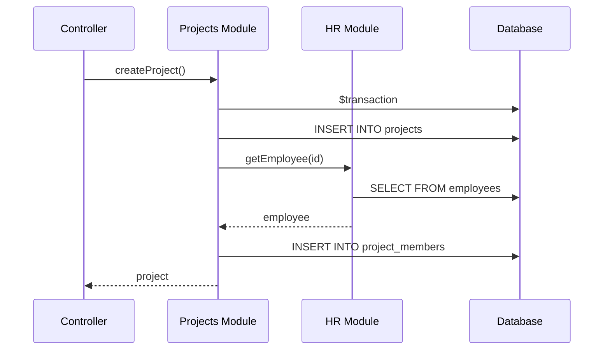

---

### 2. Multi-Tenant SaaS Pattern

**Purpose:** Complete data isolation between organizations

#### Tenant Isolation Strategy

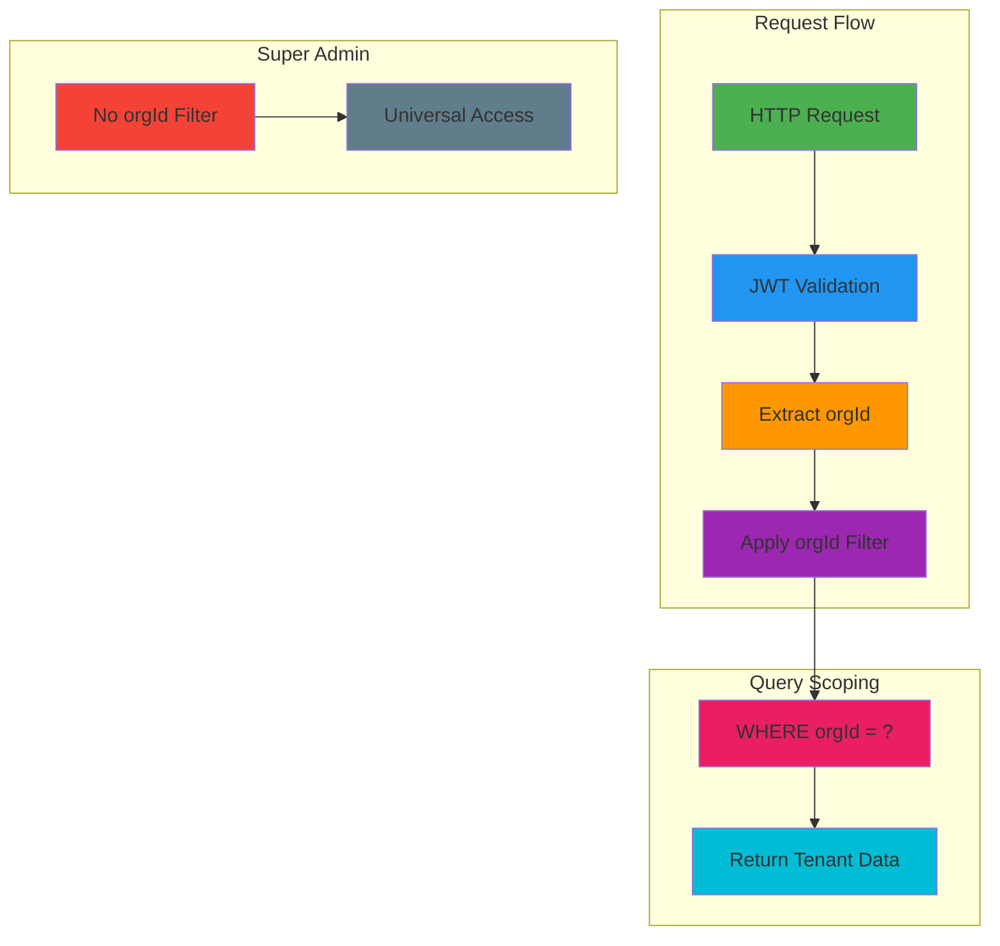

#### Implementation Pattern

```typescript
// Repository base class with tenant scoping
@Injectable()
export class BaseRepository {
  constructor(
    protected prisma: PrismaService,
    protected currentUser: CurrentUser,
  ) {}

  protected getTenantFilter() {
    if (this.currentUser.isSuperAdmin) {
      return {}; // No filter
    }
    return { organizationId: this.currentUser.organizationId };
  }

  async findMany<T>(args: Prisma.Args<T>) {
    return this.prisma[args.model].findMany({
      ...args,
      where: {
        ...args.where,
        ...this.getTenantFilter(),
      },
    });
  }
}
```

#### Tenant Data Flow

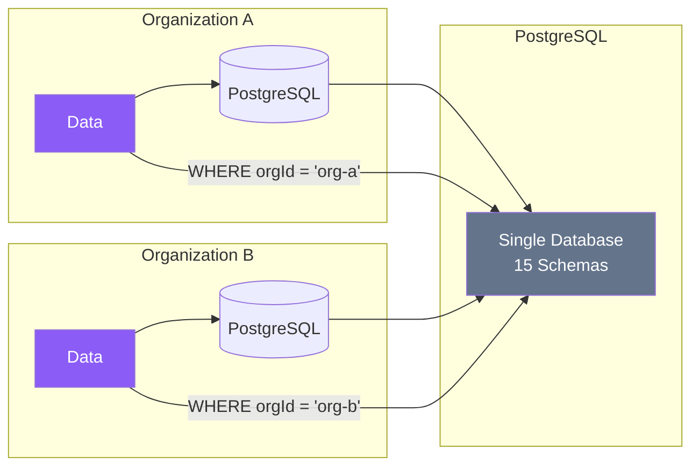

---

### 3. Domain-Driven Design (DDD) Pattern

**Purpose:** Align software architecture with business domains

#### Bounded Contexts

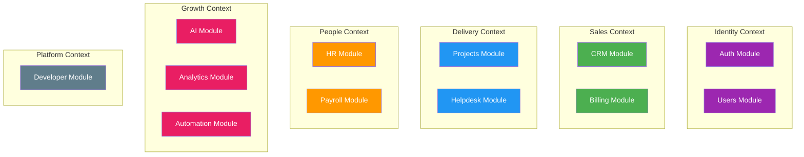

#### Aggregate Pattern

```typescript
// Project aggregate root
export class ProjectAggregate {
  private project: Project;
  private tasks: Task[];
  private members: ProjectMember[];

  constructor(project: Project) {
    this.project = project;
  }

  addTask(title: string, assignedTo: string) {
    const task = new Task({
      projectId: this.project.id,
      title,
      assignedTo,
      status: TaskStatus.TODO,
    });
    this.tasks.push(task);
    return task;
  }

  assignMember(userId: string, role: string) {
    const member = new ProjectMember({
      projectId: this.project.id,
      userId,
      role,
    });
    this.members.push(member);
    return member;
  }

  async save(repository: ProjectRepository) {
    await repository.save(this.project, this.tasks, this.members);
  }
}
```

---

### 4. CQRS (Command Query Responsibility Segregation) Pattern

**Purpose:** Separate read and write operations for performance

#### Implementation

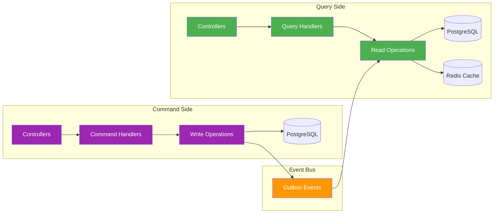

#### Command Handler Example

```typescript
@Injectable()
export class CreateProjectCommandHandler {
  constructor(
    private projectRepo: ProjectRepository,
    private eventBus: EventBus,
  ) {}

  async execute(command: CreateProjectCommand) {
    const project = await this.projectRepo.create(command.data);

    // Emit event for read model update
    await this.eventBus.publish(new ProjectCreatedEvent(project));

    return project;
  }
}
```

#### Query Handler Example

```typescript
@Injectable()
export class GetProjectsQueryHandler {
  constructor(
    private projectRepo: ProjectRepository,
    private cache: CacheService,
  ) {}

  async execute(query: GetProjectsQuery) {
    const cacheKey = `projects:${query.organizationId}`;

    // Try cache first
    const cached = await this.cache.get(cacheKey);
    if (cached) return cached;

    // Fetch from database
    const projects = await this.projectRepo.findMany({
      where: { organizationId: query.organizationId },
    });

    // Cache for 5 minutes
    await this.cache.set(cacheKey, projects, 300);

    return projects;
  }
}
```

---

### 5. Event-Driven Architecture Pattern

**Purpose:** Decouple services via asynchronous events

#### Event Flow

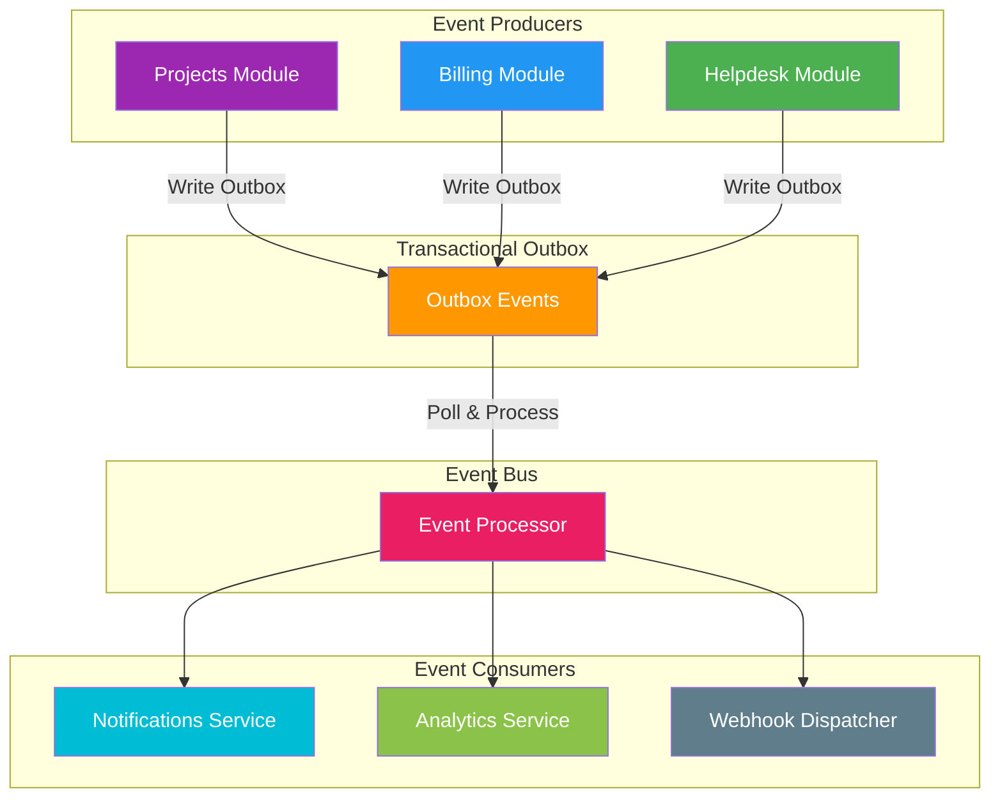

#### Outbox Pattern Implementation

```typescript
@Injectable()
export class OutboxService {
  constructor(private prisma: PrismaService) {}

  async publish(event: DomainEvent) {
    await this.prisma.outboxEvent.create({
      data: {
        eventType: event.type,
        payload: event.payload,
        idempotencyKey: event.idempotencyKey,
        organizationId: event.organizationId,
      },
    });
  }

  async processEvents() {
    const events = await this.prisma.outboxEvent.findMany({
      where: {
        status: OutboxStatus.PENDING,
        nextAttemptAt: { lte: new Date() },
      },
      take: 50,
    });

    for (const event of events) {
      await this.processEvent(event);
    }
  }

  private async processEvent(event: OutboxEvent) {
    try {
      await this.prisma.$transaction(async (tx) => {
        // Claim event with lock
        await tx.outboxEvent.updateMany({
          where: { id: event.id, status: OutboxStatus.PENDING },
          data: {
            status: OutboxStatus.PROCESSING,
            lockedAt: new Date(),
            lockedBy: process.env.HOSTNAME,
          },
        });

        // Execute handler
        await this.executeHandler(event);

        // Mark processed
        await tx.outboxEvent.update({
          where: { id: event.id },
          data: { status: OutboxStatus.PROCESSED, processedAt: new Date() },
        });
      });
    } catch (error) {
      await this.handleFailure(event, error);
    }
  }
}
```

---

### 6. Repository Pattern

**Purpose:** Abstract data access logic

#### Implementation

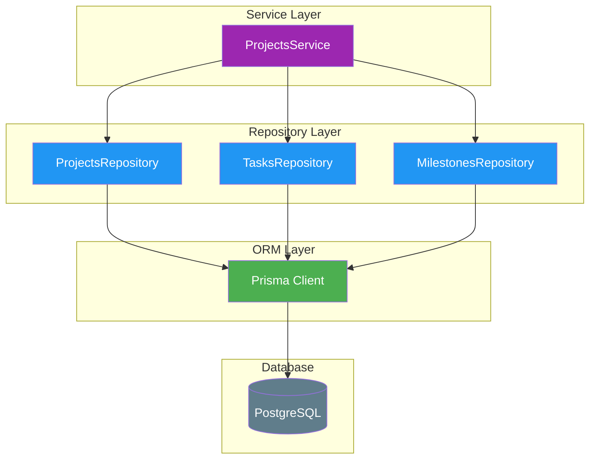

#### Repository Example

```typescript
@Injectable()
export class ProjectsRepository {
  constructor(private prisma: PrismaService) {}

  async create(data: CreateProjectDto) {
    return this.prisma.project.create({
      data,
      include: {
        members: true,
        tasks: true,
      },
    });
  }

  async findById(id: string, organizationId: string) {
    return this.prisma.project.findFirst({
      where: { id, organizationId },
      include: {
        members: true,
        tasks: true,
        milestones: true,
      },
    });
  }

  async findActive(organizationId: string) {
    return this.prisma.project.findMany({
      where: {
        organizationId,
        status: { in: [ProjectStatus.PLANNING, ProjectStatus.IN_PROGRESS] },
      },
      include: {
        members: {
          include: { user: true },
        },
      },
    });
  }

  async update(id: string, data: UpdateProjectDto) {
    return this.prisma.project.update({
      where: { id },
      data,
    });
  }

  async addMember(projectId: string, userId: string, role: string) {
    return this.prisma.projectMember.create({
      data: { projectId, userId, role },
    });
  }
}
```

---

### 7. Strategy Pattern

**Purpose:** Encapsulate interchangeable algorithms

#### Use Case: SLA Calculation

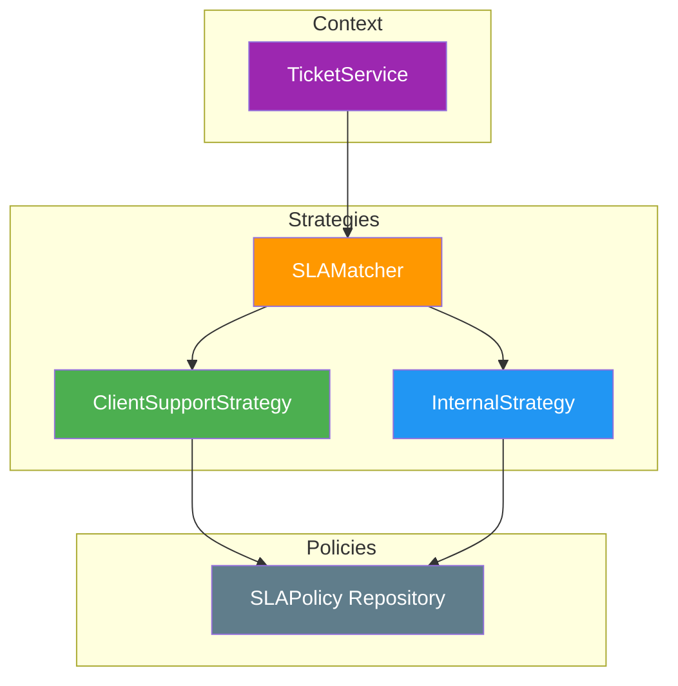

#### Implementation

```typescript
// Strategy interface
interface SLAMatchingStrategy {
  match(ticket: Ticket): Promise<SLAPolicy>;
}

// Concrete strategy
@Injectable()
export class ClientSupportSLAStrategy implements SLAMatchingStrategy {
  constructor(private slaRepo: SLAPolicyRepository) {}

  async match(ticket: Ticket): Promise<SLAPolicy> {
    // Match by specificity: department > category > priority > default
    return this.slaRepo.findBestMatch({
      organizationId: ticket.organizationId,
      ticketType: TicketType.CLIENT_SUPPORT,
      departmentId: ticket.departmentId,
      category: ticket.category,
      priority: ticket.priority,
    });
  }
}

// Context
@Injectable()
export class SLAMatcher {
  private strategies: Map<TicketType, SLAMatchingStrategy>;

  constructor(
    private clientSupport: ClientSupportSLAStrategy,
    private internal: InternalSLAStrategy,
  ) {
    this.strategies = new Map([
      [TicketType.CLIENT_SUPPORT, clientSupport],
      [TicketType.INTERNAL, internal],
    ]);
  }

  async match(ticket: Ticket): Promise<SLAPolicy> {
    const strategy = this.strategies.get(ticket.type);
    if (!strategy) {
      throw new Error(`No SLA strategy for ${ticket.type}`);
    }
    return strategy.match(ticket);
  }
}
```

---

### 8. Decorator Pattern

**Purpose:** Add behavior dynamically without modifying classes

#### Use Case: Logging & Authorization

```mermaid
graph TB
    subgraph "Decorators"
        A[@Logger]
        B[@Roles]
        C[@OrganizationScoped]
    end

    subgraph "Controllers"
        D[ProjectsController]
        E[TicketsController]
    end

    subgraph "Execution"
        F[Decorator Chain]
        G[Handler]
    end

    A --> D
    B --> D
    C --> D
    A --> E
    B --> E
    C --> E
    D --> F
    E --> F
    F --> G

    style A fill:#FF9800,color:#fff
    style B fill:#2196F3,color:#fff
    style C fill:#4CAF50,color:#fff
    style D fill:#9C27B0,color:#fff
    style E fill:#9C27B0,color:#fff
    style F fill:#E91E63,color:#fff
    style G fill:#607D8B,color:#fff
```

#### Implementation

```typescript
// Logger decorator
export function Logger(target: any, propertyKey: string, descriptor: PropertyDescriptor) {
  const originalMethod = descriptor.value;

  descriptor.value = async function (...args: any[]) {
    const start = Date.now();
    console.log(`[${propertyKey}] Started`);

    try {
      const result = await originalMethod.apply(this, args);
      const duration = Date.now() - start;
      console.log(`[${propertyKey}] Completed in ${duration}ms`);
      return result;
    } catch (error) {
      console.error(`[${propertyKey}] Failed:`, error);
      throw error;
    }
  };

  return descriptor;
}

// Usage
@Controller('projects')
export class ProjectsController {
  @Post()
  @Logger()
  @Roles('ADMIN', 'PROJECT_MANAGER')
  @OrganizationScoped
  async create(@Body() dto: CreateProjectDto) {
    return this.projectsService.create(dto);
  }
}
```

---

### 9. Factory Pattern

**Purpose:** Create objects without specifying exact class

#### Use Case: Notification Creation

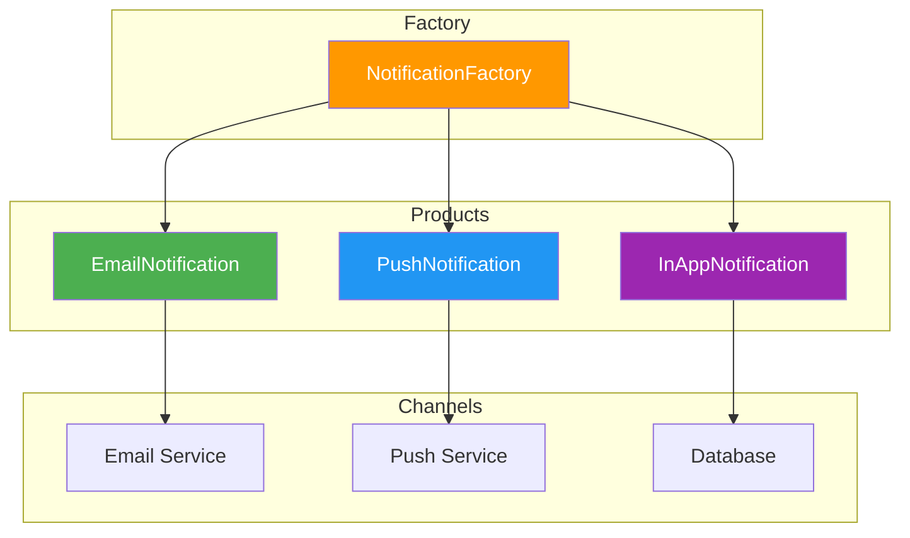

#### Implementation

```typescript
export interface Notification {
  send(): Promise<void>;
}

export class EmailNotification implements Notification {
  constructor(
    private recipient: string,
    private subject: string,
    private body: string,
  ) {}

  async send() {
    await emailService.send({
      to: this.recipient,
      subject: this.subject,
      body: this.body,
    });
  }
}

export class InAppNotification implements Notification {
  constructor(
    private userId: string,
    private title: string,
    private message: string,
  ) {}

  async send() {
    await prisma.notification.create({
      data: {
        userId: this.userId,
        title: this.title,
        message: this.message,
      },
    });
  }
}

@Injectable()
export class NotificationFactory {
  create(type: NotificationType, data: NotificationData): Notification {
    switch (type) {
      case NotificationType.EMAIL:
        return new EmailNotification(data.recipient, data.subject, data.body);
      case NotificationType.IN_APP:
        return new InAppNotification(data.userId, data.title, data.message);
      default:
        throw new Error(`Unknown notification type: ${type}`);
    }
  }
}
```

---

### 10. Observer Pattern

**Purpose:** Subscribe to and react to events

#### Use Case: Ticket Status Changes

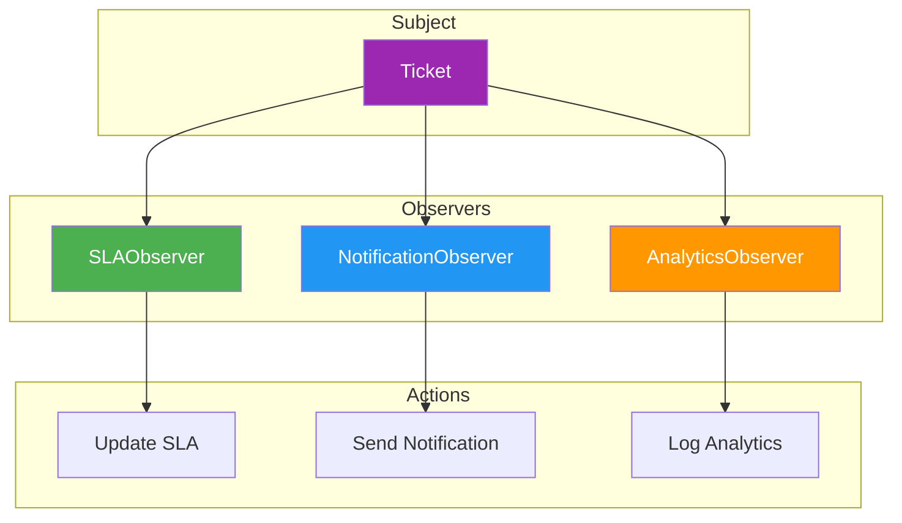

#### Implementation

```typescript
// Observer interface
interface TicketObserver {
  onStatusChanged(ticket: Ticket, oldStatus: TicketStatus): Promise<void>;
}

// Concrete observer
@Injectable()
export class SLAObserver implements TicketObserver {
  constructor(private slaService: SLAService) {}

  async onStatusChanged(ticket: Ticket, oldStatus: TicketStatus) {
    if (ticket.status === TicketStatus.ASSIGNED && oldStatus === TicketStatus.OPEN) {
      await this.slaService.startResponseClock(ticket);
    }

    if (ticket.status === TicketStatus.RESOLVED) {
      await this.slaService.stopResolutionClock(ticket);
    }
  }
}

// Subject
@Injectable()
export class TicketService {
  private observers: TicketObserver[] = [];

  constructor(
    private slaObserver: SLAObserver,
    private notificationObserver: NotificationObserver,
  ) {
    this.observers.push(slaObserver, notificationObserver);
  }

  async updateStatus(id: string, status: TicketStatus) {
    const ticket = await this.findById(id);
    const oldStatus = ticket.status;

    ticket.status = status;
    await this.save(ticket);

    // Notify observers
    for (const observer of this.observers) {
      await observer.onStatusChanged(ticket, oldStatus);
    }

    return ticket;
  }
}
```

---

## 🔒 Security Patterns

### 1. Authentication Pattern

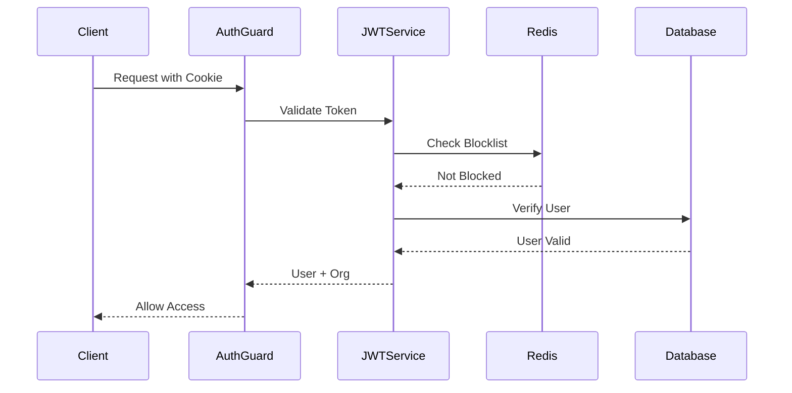

#### Implementation

```typescript
@Injectable()
export class JwtAuthGuard implements CanActivate {
  constructor(
    private jwtService: JwtService,
    private redis: RedisService,
    private prisma: PrismaService,
  ) {}

  async canActivate(context: ExecutionContext): Promise<boolean> {
    const request = context.switchToHttp().getRequest();
    const token = this.extractTokenFromCookie(request);

    if (!token) {
      throw new UnauthorizedException('No token provided');
    }

    // Check blocklist
    const isBlocked = await this.redis.get(`blocklist:${token}`);
    if (isBlocked) {
      throw new UnauthorizedException('Token revoked');
    }

    // Verify token
    const payload = this.jwtService.verify(token);

    // Verify user exists
    const user = await this.prisma.user.findUnique({
      where: { id: payload.sub },
      include: { organization: true },
    });

    if (!user || !user.isActive) {
      throw new UnauthorizedException('User not found or inactive');
    }

    request.user = user;
    return true;
  }
}
```

### 2. Authorization Pattern (RBAC)

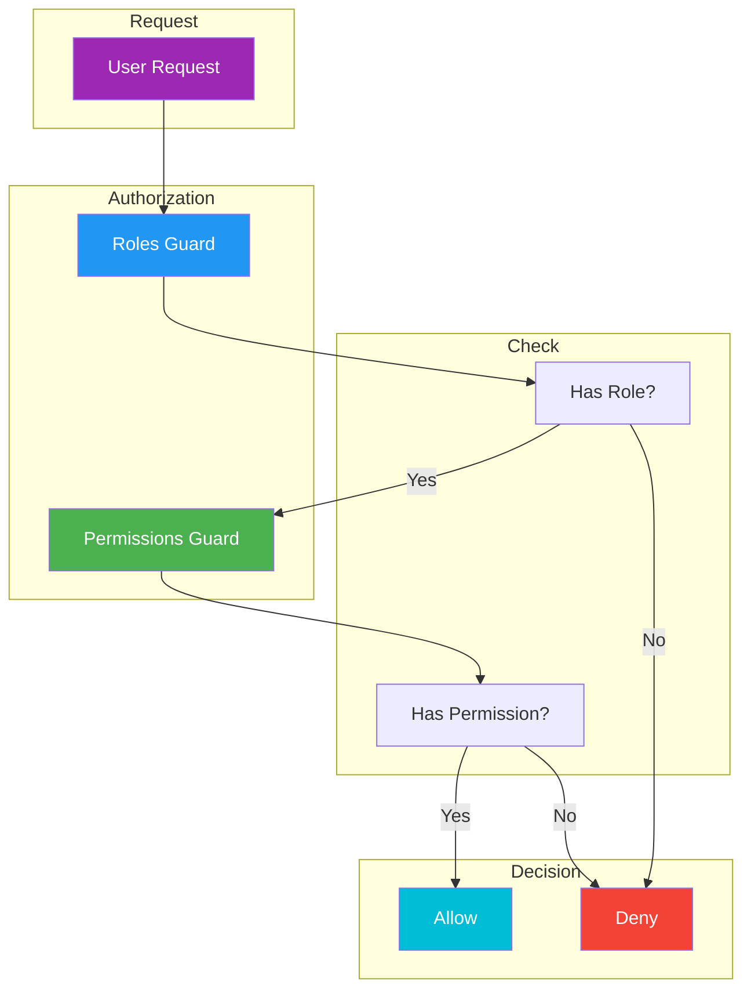

#### Implementation

```typescript
@Injectable()
export class RolesGuard implements CanActivate {
  constructor(private reflector: Reflector) {}

  canActivate(context: ExecutionContext): boolean {
    const requiredRoles = this.reflector.get<string[]>('roles', context.getHandler());

    if (!requiredRoles) {
      return true;
    }

    const { user } = context.switchToHttp().getRequest();
    return requiredRoles.some((role) => user.roles?.includes(role));
  }
}

// Usage
@Controller('projects')
export class ProjectsController {
  @Post()
  @Roles('ADMIN', 'PROJECT_MANAGER')
  async create(@Body() dto: CreateProjectDto) {
    return this.projectsService.create(dto);
  }
}
```

### 3. Rate Limiting Pattern

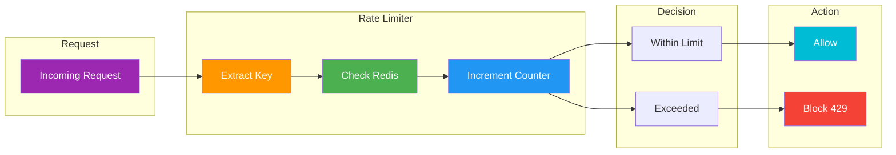

#### Implementation

```typescript
@Injectable()
export class ThrottlerGuard extends ThrottlerGuard {
  constructor(
    @Inject(THROTTLER_OPTIONS) private options: ThrottlerModuleOptions,
    private redis: RedisService,
  ) {
    super(options);
  }

  async handleRequest(request: any, limit: number, ttl: number): Promise<boolean> {
    const key = this.generateKey(request);
    const current = await this.redis.incr(key);

    if (current === 1) {
      await this.redis.expire(key, ttl);
    }

    if (current > limit) {
      throw new ThrottlerException();
    }

    return true;
  }

  private generateKey(request: any): string {
    const ip = request.ip;
    const path = request.route?.path || request.url;
    return `rate-limit:${ip}:${path}`;
  }
}
```

---

## 🔄 Integration Patterns

### 1. API Gateway Pattern

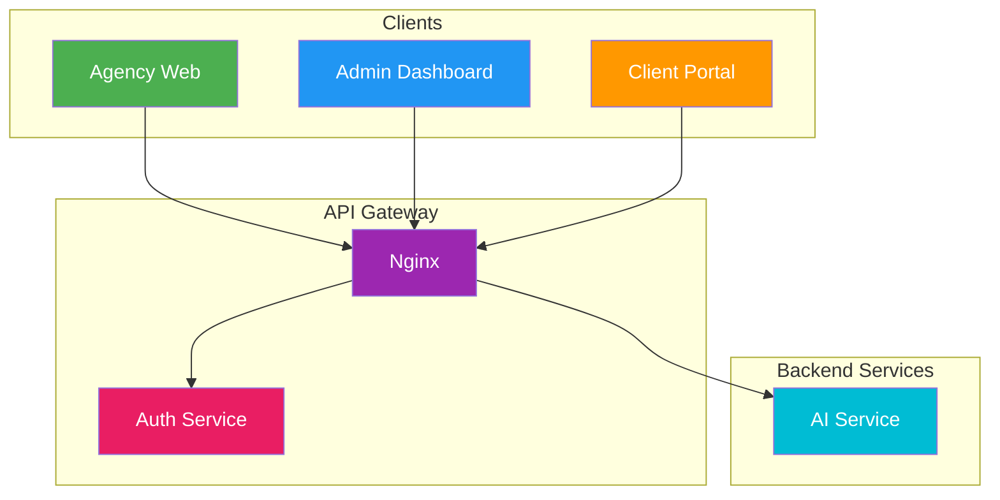

### 2. Circuit Breaker Pattern

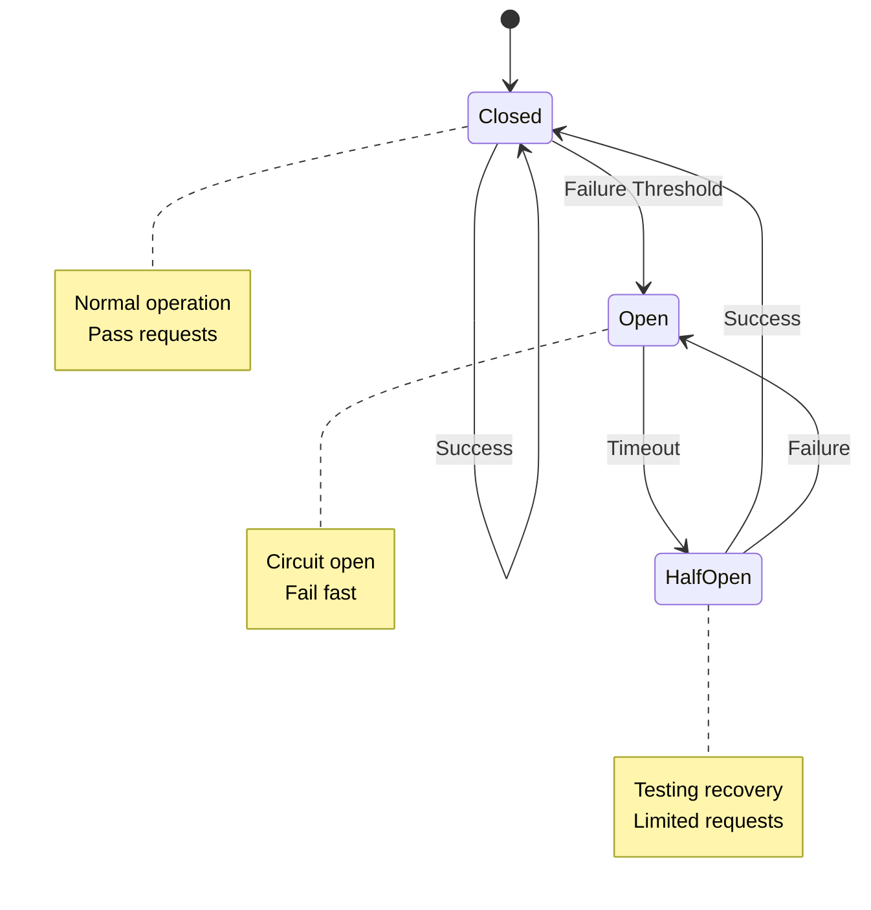

#### Implementation

```typescript
@Injectable()
export class CircuitBreakerService {
  private state = 'CLOSED';
  private failureCount = 0;
  private lastFailureTime = 0;
  private readonly threshold = 5;
  private readonly timeout = 60000; // 1 minute

  async execute<T>(fn: () => Promise<T>): Promise<T> {
    if (this.state === 'OPEN') {
      if (Date.now() - this.lastFailureTime > this.timeout) {
        this.state = 'HALF_OPEN';
      } else {
        throw new ServiceUnavailableException('Circuit breaker is OPEN');
      }
    }

    try {
      const result = await fn();
      this.onSuccess();
      return result;
    } catch (error) {
      this.onFailure();
      throw error;
    }
  }

  private onSuccess() {
    this.failureCount = 0;
    if (this.state === 'HALF_OPEN') {
      this.state = 'CLOSED';
    }
  }

  private onFailure() {
    this.failureCount++;
    this.lastFailureTime = Date.now();

    if (this.failureCount >= this.threshold) {
      this.state = 'OPEN';
    }
  }
}
```

---

## 📊 Performance Patterns

### 1. Caching Pattern

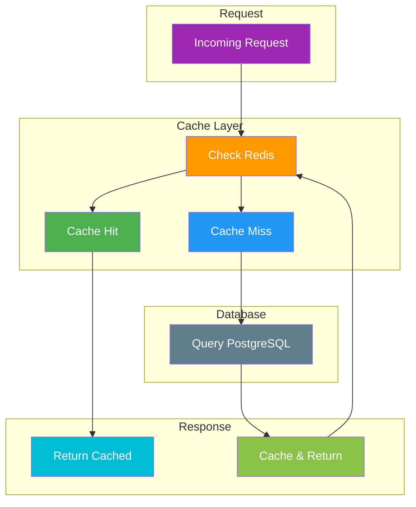

#### Implementation

```typescript
@Injectable()
export class CacheService {
  constructor(private redis: RedisService) {}

  async get<T>(key: string): Promise<T | null> {
    const cached = await this.redis.get(key);
    return cached ? JSON.parse(cached) : null;
  }

  async set(key: string, value: any, ttl: number = 300) {
    await this.redis.set(key, JSON.stringify(value), 'EX', ttl);
  }

  async invalidate(pattern: string) {
    const keys = await this.redis.keys(pattern);
    if (keys.length > 0) {
      await this.redis.del(...keys);
    }
  }

  async getOrSet<T>(
    key: string,
    factory: () => Promise<T>,
    ttl: number = 300,
  ): Promise<T> {
    const cached = await this.get<T>(key);
    if (cached) return cached;

    const value = await factory();
    await this.set(key, value, ttl);
    return value;
  }
}
```

### 2. Pagination Pattern

```typescript
@Injectable()
export class PaginationService {
  static parse<T>(query: any): Prisma.Args<T> {
    const page = Math.max(1, parseInt(query.page) || 1);
    const limit = Math.min(100, Math.max(1, parseInt(query.limit) || 20));
    const skip = (page - 1) * limit;

    return {
      skip,
      take: limit,
    };
  }

  static format<T>(data: T[], total: number, page: number, limit: number) {
    return {
      data,
      meta: {
        total,
        page,
        limit,
        totalPages: Math.ceil(total / limit),
      },
    };
  }
}
```

---

## 🎯 Best Practices Summary

### Module Design

1. **Single Responsibility:** Each module handles one domain
2. **Loose Coupling:** Modules communicate via interfaces/events
3. **High Cohesion:** Related functionality grouped together
4. **Explicit Boundaries:** Clear public APIs for each module

### Data Access

1. **Repository Pattern:** Abstract all database access
2. **Transaction Safety:** Use `$transaction` for multi-step writes
3. **Query Bounding:** Always use `take` to prevent large result sets
4. **Index Awareness:** Design queries with indexes in mind

### Error Handling

1. **Consistent Exceptions:** Use NestJS built-in exceptions
2. **Error Logging:** All errors logged with context
3. **User Safety:** Never expose stack traces to clients
4. **Retry Logic:** Implement exponential backoff for transient failures

### Security

1. **Principle of Least Privilege:** Minimal required permissions
2. **Defense in Depth:** Multiple security layers
3. **Input Validation:** Validate all user input
4. **Output Encoding:** Prevent XSS attacks

### Performance

1. **Caching Strategy:** Cache frequently accessed data
2. **Lazy Loading:** Load related data only when needed
3. **Batch Operations:** Use bulk operations where possible
4. **Connection Pooling:** Configure appropriate pool sizes

---

## 📚 Related Documentation

- [Complete System Architecture](SYSTEM_ARCHITECTURE.md) - Overall system design
- [Database Schema Complete Guide](../DATABASE_SCHEMA_COMPLETE_GUIDE.md) - Database patterns
- [Authentication Flow](auth-flow.md) - Auth implementation details
- [Ecosystem Overview](ecosystem.md) - Project dependencies

---

**Document Status:** ✅ Complete  
**Last Review:** 2026-10-11  
**Next Review:** 2026-11-11
