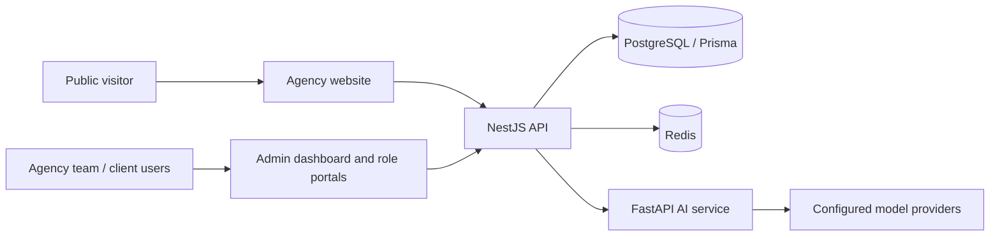

# Architecture Guide

## System context

AgencyOS is a monorepo with two Next.js applications, a NestJS modular backend, a FastAPI AI service and shared workspace packages.

## Runtime components

| Component | Source path | Responsibility |
|---|---|---|
| Public website | `apps/agency-web` | Marketing, services, portfolio, blog and contact capture |
| Role dashboard | `apps/admin-dashboard` | Administrative and role-oriented workspaces |
| Core API | `services/auth` | Authentication and application-domain modules |
| AI service | `services/ai-service` | Internal AI endpoints and model-provider calls |
| Database package | `packages/database` | Prisma schema/client/migrations |
| Shared types | `packages/types` | Cross-package type contracts |
| UI package | `packages/ui` | Shared component package |
| Config package | `packages/config` | Shared configuration |

## Backend module domains

The NestJS root module imports modules for authentication, users, billing, projects, clients, HR, payroll, AI, analytics, automation, helpdesk/ticketing, notifications, developer tools, outbox delivery, gateway/WebSocket functionality, secrets, queues, storage, email, health and failover operations.

Module presence does not prove every endpoint is complete or available to every role. Inspect controllers, guards, DTOs, services and tests for the specific feature being integrated.

## Data and tenancy

PostgreSQL accessed through Prisma is the primary data store. Redis supports cache, rate-limit and ephemeral coordination features. MongoDB appears in some infrastructure configuration but is not described here as an application source of truth; verify actual usage before introducing a dependency.

The platform supports organization-scoped data. Tenant identifiers must come from authenticated server-side context. All reads and writes must apply organization scope, and tests should explicitly cover cross-tenant denial. See [tenant isolation](tenant-isolation.md).

## Authentication

The API configures JWT/cookie authentication and documents an exchange-code approach for deployments across separate frontend origins. Read [authentication flow](auth-flow.md), then verify current implementation and deployment cookie/CORS settings before changing the flow.

## Ports

| Service | Local port |
|---|---:|
| Agency website | 3000 |
| Admin dashboard | 3001 |
| NestJS API | 8000 |
| FastAPI AI service | 8001 (host mapping; container listens on 8000) |
| PostgreSQL | 5432 |
| Redis | 6379 |

## Design constraints

- Keep tenant scope server-derived and explicit.
- Use transactions for logically atomic multi-step writes.
- Avoid coupling the UI directly to database implementation details.
- Keep provider credentials on the server.
- Make external integrations optional/configurable where possible.
- Update architecture docs when adding a new service or datastore.
